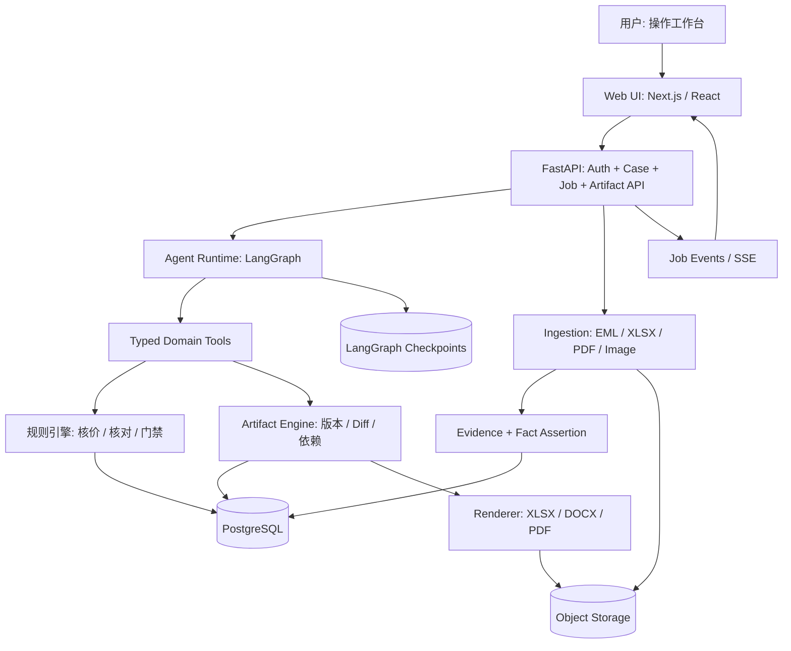

# 00｜系统总架构：TradeWorkbench 技术蓝图

> 状态：**推荐方案，等待团队技术评审** ｜ 版本：Tech Design v1.0 ｜ 2026-10-31  
> 前提：首版为 B2B 箱包 OEM/ODM 的**单人主操作者**工作台，面向 Hackathon MVP，而不是正式 ERP/PLM。  
> 对应产品：[PRD v1.0](../references/PRD-v1.0.md)

## 1. 系统要解决的核心问题

用户提供询盘、图片、Excel/PDF 报价和 PO，Agent 在同一 Case 内连续完成：规格整理 → 询价 → 成本核算 → 客户报价 → 客户变更 → 跨成果更新 → PO 核对 → PI/生产资料草稿。所有成果真实可编辑、可导出，且涉及商业承诺时有审批门禁。

**一条主线**：`Source → Fact Assertion → Resolved Fact → Job/Tool → Artifact Draft → Validation → Review → Release/Export`。

### 三个不能混为一谈的“完成”

| 层次 | 可声称完成的条件 | 不能声称什么 |
|---|---|---|
| Agent 执行完成 | Tool 调用成功，成果草稿已保存，校验有结论 | 不代表客户/供应商已同意 |
| 内部文件发布完成 | 指定版本通过校验，拥有必要内部审批 | 不代表文件已发送、工厂已开工 |
| 外部业务完成 | 有真实外部发送/签收/确认/履约证据 | 不能以模拟回复、生成 PDF 代替 |

## 2. 组件、职责与数据流

**明确的所有权**：
- Web UI **只处理呈现、可编辑草稿和交互选择**，不自行决定业务发布或审批通过。
- FastAPI 是权限、并发、事务与输入验证的统一入口。
- Agent Runtime 决定下一步调用哪个受控工具，**不直接写正式订单/版本表**。
- Domain Tools 负责业务变更、数值计算与规则校验，离开 LLM 也能够单独运行测试。
- Artifact Engine 负责结构化快照、差异、依赖、导出；不是“把文件丢给模型任意修改”。
- PostgreSQL 保存业务事实与版本；Object Storage 保存源文件与导出文件；Checkpoint 保存运行进度，两者**不能相互代替**。

## 3. P0 必备模块与后置模块

| 模块 | P0 最低能力 | P1 或后置 |
|---|---|---|
| 工作台 | Case 切换、资料树、AG Grid、Agent 轨迹、Diff、审批与下载 | 通用 Office 无损编辑器、多人实时协同 |
| 解析 | EML、XLSX、文字型 PDF、图片的 VLM 描述；Source Locator | 批量邮箱同步、复杂扫描件全自动抽取 |
| 事实层 | 多来源断言、状态、可追溯确认、事实冲突阻断 | 大规模事实图谱 / 自动搜索所有历史邮件 |
| 工件层 | 规格、RFQ、供应商比较、Cost Sheet、Quotation、PI/生产指令 | 任意模板无损往返、复杂公式工作簿 |
| Agent | 主 Agent、受控 Tool Calling、任务中断/恢复 | 多 Agent Swarm、自主跨系统动作 |
| 工作流 | Flow A/B/C；报价和生产门禁 | 生产进度自动跟催、物流和收款集成 |
| 基建 | PostgreSQL、对象存储、持久执行事件、备份 | 分布式队列、复杂微服务和 K8s |

## 4. 核心架构不变量（禁止回归）

1. **Case 隔离**：`case_id` 必须从认证上下文授权后查询，LLM 传入的 Case ID 不能绕过授权。
2. **原始 Source 不可变**：上传之后只追加解析结果、索引或版本，不修改原始字节；保留 SHA-256。
3. **已发布 ArtifactVersion 不可变**：任何编辑都会创建新草稿版本，旧版可重现。
4. **事实先断言、后授权采用**：新客户邮件只表示提出/声称；不能自动覆盖已确认报价和生产规格。
5. **人工接受 Patch ≠ 内部报价批准 ≠ 客户规格批准 ≠ 生产放行批准**：分别通过独立 Gate 判定。
6. **钱、数量、日期基于类型化数据和确定性规则**：LLM 只做信息抽取或理由解释，不做最终金额真值计算。
7. **外部操作默认不执行**：P0 仅“准备”邮件与导出，不假装已发出。
8. **失败可恢复，副作用幂等**：Agent 重试/重启不能重复发布、重复导出记录或重复发送。
9. **最小可观测性**：每个 Job / Tool / 修改 / 审批可通过 ID 追溯。

## 5. 推荐技术栈（非必须锁死版本）

| 层 | 推荐 | 备选与取舍 |
|---|---|---|
| UI | Next.js + React + TypeScript + Tailwind / shadcn | Vite + React 可更轻；SSR 不是业务硬要求 |
| 表格 | AG Grid Community（只利用其可编辑表格能力） | Univer Core；如需完整 Office 往返需重新做授权/技术评估 |
| 富文本 | Tiptap | 简单 textarea 模板也能完成 P0 首版 |
| API | FastAPI + Pydantic + SQLAlchemy/Alembic | 采用异步/同步一种数据库访问风格，避免混用 |
| Agent | LangGraph + 模型适配层 | 简化状态机在极短 Hackathon 下可替代；只选一种编排系统 |
| 存储 | PostgreSQL + MinIO/S3 | 本地文件目录仅限单机临时原型 |
| 解析 | openpyxl / Python email / Docling / VLM | PDF 文本层可走轻量解析器作为 fallback |
| 生成 | openpyxl / python-docx / PDF Renderer | 不使用 AG Grid Community 的付费 Excel Export |
| 任务 | 独立 Worker + 持久 Event Log | P0 可先单 Worker；长任务不要绑定前端 HTTP 请求 |
| 集成 | n8n（P1） | 不让 n8n 成为版本/审批事实存储 |

## 6. 基本运行拓扑（MVP）

- `web`：Next.js 前端。
- `api`：FastAPI，认证、资源授权、事务、REST、SSE。
- `worker`：Agent Run + 文档解析/生成执行；生产环境不要在 API 进程运行不可恢复的长任务。
- `postgres`：领域表、Job Event、LangGraph Checkpoint（可以同实例不同 schema）。
- `minio`：Source 原始文件、输出文件和可选预览缓存。
- `redis`：**可选**，如需 RQ/Celery；不必为了 1～2 个 Job 引入复杂消息系统。

推荐先单个 Monorepo，**模块化单体 + 独立 Worker**，先不要拆多个微服务。

## 7. 最小端到端调用（例）

1. 用户上传客户 `inquiry.eml` → `POST /cases/{id}/sources`；立即保存源文件元数据与不可变字节。
2. Worker 解析并生成 `FactAssertion`；UI 可查看未知项、来源定位。
3. 用户发起 `prepare_quotation` Job；Agent 加载当前 Case 与有效的业务字段。
4. Agent 通过 `create_spec_draft`、`normalize_supplier_quotes`、`calculate_quote`、`create_quotation_draft` 得到独立的结构化工件版本。
5. 校验器标出 `BLOCK` / `REVIEW` / `INFO`，其中缺少关键包装成本会阻止正式报价发布，但不阻止草稿。
6. 用户收到客户包装变更；新 `ChangeSet` 关联原邮件，依赖分析找到受影响的工件，提出 Patch 而不覆盖已发布版本。
7. 用户审核后，系统再次检查 `base_version` 与审批范围；生成新版本并记录审批；后续 PO Job 消费明确指定的已批准快照。

## 8. 与其他文档的边界

- 实体字段及 SQL 参见 [02 数据模型](../01-domain/02-domain-data-model.md)。
- Patch、Diff、依赖参见 [04 Artifact Engine](../02-artifacts/04-artifact-engine.md)。
- Agent 运行、暂停/恢复参见 [06 Agent Runtime](../03-agents/06-agent-runtime.md)。
- 技术实现先后与任务拆分参见 [15 实施计划](../07-delivery/15-implementation-plan.md)。

## 9. 来源与核对

- 当前产品边界来自 PRD / 用户提供的跟单工作调研，属于**本项目设计决定**，不是外部技术标准。
- AG Grid Community 功能范围：https://github.com/ag-grid/ag-grid （Community 支持 cell editing / CSV export，原生 Excel export、公式属于 Enterprise 能力）。
- LangGraph 持久化：https://docs.langchain.com/oss/python/langgraph/persistence
- Univer 功能与授权范围：https://www.univer.ai/pricing/
