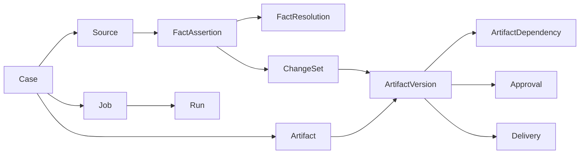

# 02｜领域与数据模型：最小业务事实底座

> Owner：后端 / 领域工程师 ｜ 状态：**推荐实现草案**  
> 目标：不是新建 CRM，而是为跨文件执行提供**可追溯、可审计、可恢复**的数据契约。

## 1. 三层领域模型



**原始层**（Source / FactAssertion）：记录“谁在何时说了什么，原文位于何处”。  
**决策层**（FactResolution / Approval / ChangeSet）：记录“哪条要求对哪个业务环节生效，谁有权确认”。  
**执行层**（Job / Run / Artifact / Delivery）：记录“做了什么、产出了什么、发出去了没有”。

## 2. 关键实体与字段表

| 表 | 关键字段 | 不变量 / 索引 |
|---|---|---|
| `cases` | `id`, `workspace_id`, `title`, `owner_id`, `stage`, `created_at` | `(workspace_id, id)` 作为所有授权查询边界 |
| `sources` | `id`, `case_id`, `name`, `mime_type`, `sha256`, `storage_key`, `received_at`, `uploaded_by` | 内容不可变；`sha256` 去重提示不等于跨 Case 可见 |
| `source_spans` | `id`, `source_id`, `locator_json`, `text_excerpt`, `parse_version` | 定位支持页码、表格坐标和邮件正文片段 |
| `fact_assertions` | `id`, `case_id`, `field_path`, `value_json`, `assertion_kind`, `source_span_id`, `asserted_by`, `observed_at` | 不因出现较新信息就删除旧断言 |
| `fact_resolutions` | `id`, `case_id`, `field_path`, `scope`, `assertion_id`, `status`, `confirmed_by`, `approved_evidence_id` | 同一字段 + scope 最多一个当前有效 Resolution（事务保证） |
| `artifacts` | `id`, `case_id`, `kind`, `title`, `active_draft_version_id`, `released_version_id` | Draft 指针和 Released 指针明确分离 |
| `artifact_versions` | `id`, `artifact_id`, `version_no`, `schema_version`, `content_json`, `content_hash`, `base_version_id`, `generated_by_run_id` | 快照不可变；`(artifact_id, version_no)` 唯一 |
| `artifact_dependencies` | `downstream_version_id`, `upstream_version_id`, `field_paths`, `dependency_kind` | 输出版本知道用过哪一版上游 |
| `change_sets` | `id`, `case_id`, `source_id`, `base_snapshot`, `operations_json`, `status` | 只能 propose/validate/apply；不能隐式发布 |
| `jobs` | `id`, `case_id`, `goal`, `created_by`, `status` | 目标保持，人可持续发起多个 Run |
| `runs` | `id`, `job_id`, `thread_id`, `checkpoint_ref`, `status`, `started_at` | 同 Run 多次重试同一操作幂等 |
| `job_events` | `id`, `run_id`, `seq`, `type`, `payload_json`, `created_at` | `(run_id, seq)` 唯一；UI 从事件恢复进度 |
| `approvals` | `id`, `case_id`, `target_type`, `target_version_id`, `scope`, `decision`, `actor_id`, `evidence_id`, `created_at` | 绑定具体哈希/版本、角色和范围 |
| `deliveries` | `id`, `case_id`, `artifact_version_ids`, `channel`, `status`, `authorization_id`, `external_ref` | `prepared != exported != sent != acknowledged` |
| `tool_invocations` | `id`, `run_id`, `tool_name`, `idempotency_key`, `status`, `result_ref` | 幂等键唯一（按业务作用域） |

### 为什么 FactResolution 要有 scope？

同一条 `spec.packaging.type=custom_color_box` 可能：
- 在 `customer_requirement` 范围已由客户明确提出；
- 在 `supplier_capability` 尚未获得工厂确认；
- 在 `pricing_release` 尚未获得负责人批准；
- 在 `production_release` 尚未通过放行门禁。

这些状态**不能合并为一个布尔型批准值**。`FactResolution` 不等于直接赋予所有 Gate 通行权；最终业务发布仍按 Gate 收集对应证据。

## 3. 结构化值和类型

所有金额、数量、单位、时间必须带类型：

```json
{
  "field_path": "cost.packaging.unit_cost",
  "value": {"amount": "5.00", "currency": "CNY", "unit": "piece"},
  "source_locator": {
    "type": "xlsx",
    "sheet": "Quotation",
    "cell": "F12"
  },
  "assertion_kind": "supplier_quote",
  "status": "observed"
}
```

- `Decimal` 在 JSON 中采用**十进制字符串**，避免 JS float 导致货币误差。
- 数量区分 `piece / carton / set`；成本单位和币种必须能归一化。
- 时间一律 ISO8601 + 时区；业务日期（如 `planned_ship_date`）单独使用 `YYYY-MM-DD`，避免时区移动一天。
- Field Path 使用业务语义，如 `spec.logo.width_mm`；**不要用 `C17` 或中文列名充当字段主键**。
- unknown 不得通过 `0`、空字符串或模型猜测表示。建议值对象：`{ "kind":"unknown", "reason":"not_in_source" }`。

## 4. Fact 与审批示例

客户邮件：“Please switch to custom color box. Keep the ship date if possible.”

```json
{
  "assertion_id": "fa_007",
  "field_path": "spec.packaging.type",
  "value_json": {"kind":"known", "value":"custom_color_box"},
  "assertion_kind": "change_request",
  "source_span_id": "span_email_007_2",
  "observed_at": "2026-10-31T09:15:00Z"
}
```

可以创建 `ChangeSet` / 新 Spec 草稿；但 `pricing_release` 和 `production_release` Gate 仍需要供应商报价、交期与责任人的审批。即使客户邮件来自真实邮箱，它也**不自动构成内部成本批准**。

## 5. 推荐的数据库约束（概念 SQL）

```sql
CREATE TABLE artifact_versions (
  id uuid PRIMARY KEY,
  artifact_id uuid NOT NULL REFERENCES artifacts(id),
  version_no integer NOT NULL CHECK (version_no > 0),
  schema_version text NOT NULL,
  content_json jsonb NOT NULL,
  content_hash text NOT NULL,
  base_version_id uuid NULL,
  created_at timestamptz NOT NULL DEFAULT now(),
  UNIQUE (artifact_id, version_no)
);

-- 以领域事件而非直接更新 version 内容记录变更；
-- 对已发布快照执行 UPDATE/DELETE 的路径必须封禁。
```

实际迁移中需处理 `artifacts` 与 `artifact_versions` 双向外键创建顺序、业务作用域索引、Check Constraints、Trigger 和权限角色；上例**不是完整生产数据库 DDL**。

**建议索引**：`sources(case_id, received_at)`、`fact_assertions(case_id, field_path, observed_at)`、`artifacts(case_id,kind)`、`job_events(run_id, seq)`、`approvals(case_id,target_type,target_version_id,scope)`。

## 6. Write API 事务与乐观并发

一次保存的流程：

1. 后端验证 JWT/Session 和 Case 所属 workspace、写入权限；
2. 提交 `base_version_id` 和 `If-Match`/版本号；
3. 在数据库事务内锁定目标 Artifact 头记录，比较现有草稿版本指针；
4. 如果过期，返回 HTTP `409 ARTIFACT_VERSION_CONFLICT`，并提供最新版本 ID；
5. 创建新的不可变 `artifact_versions`；校验数据；更新 `active_draft_version_id`；追加领域事件；
6. 提交事务后由独立 Worker 处理潜在下游失效（可用可靠事件表 / transactional outbox）。

**跨版本覆盖原则**：并发冲突必须显式比较/重放，不能 `last write wins`。

## 7. 数据生命周期 / 最小安全

- Source 按 Case 存储，并进行 workspace 范围权限检查；从模型获得的 source_id 不构成访问权限。
- 原始文件需去重时，只在授权边界内呈现；跨组织物理对象去重不得泄露存在性。
- 断言保留原始、转换后的标准化值和 Parser 版本，允许随新解析器追加新断言，不原位篡改历史。
- 所有删除和保留策略由组织配置；P0 可暂不开放“永久删除历史”UI，但需定义撤销发布的行为（新版本替代，非删历史）。
- 敏感信息（客户价格、联系方式、银行信息）不应默认出现在 Agent Trace / 日志。

## 8. P0 任务列表与验收

- [ ] Alembic 初始迁移覆盖 Case/Source/Assertion/Resolution/Artifact/Version/ChangeSet/Job/Run/Approval/Event。
- [ ] 所有写接口强制 Case Scope；跨 Case 查询构造 403/404 测试。
- [ ] 客户邮件产生 `observed` 断言后，不改变已确认 `pricing_release` 的 Resolution。
- [ ] 已发布版本更新/删除被禁止，创建新版本可追踪。
- [ ] 两个请求基于同一版本写入，第二个返回 409。
- [ ] 事件、审批与导出记录都可按 `case_id + version_id` 追溯。

**衔接**：[04 Artifact Engine](../02-artifacts/04-artifact-engine.md) / [11 安全与审批](../06-platform/11-security-approvals.md)。
