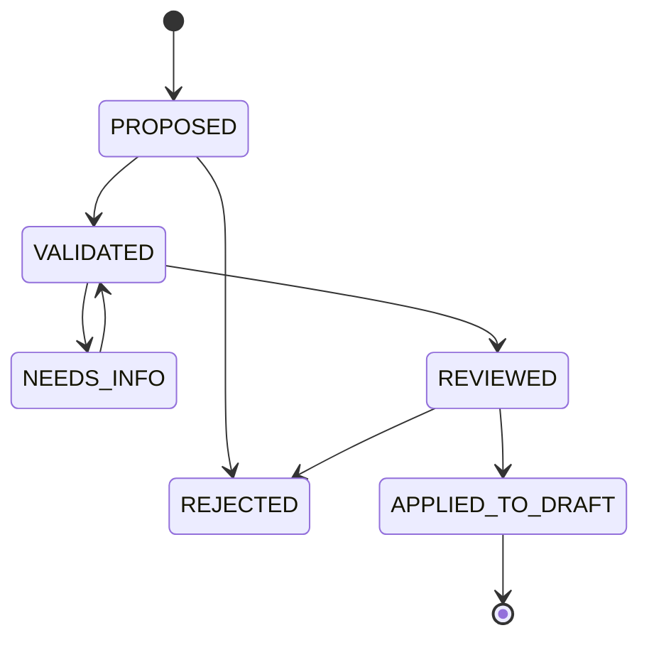
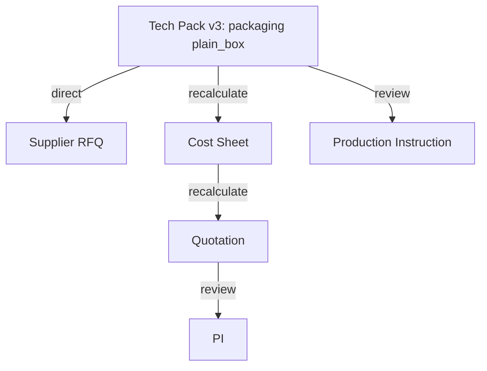

# 04｜Artifact Engine：可编辑工件、版本、依赖、Diff 与变更提交

> Owner：后端领域工程师（核心）+ 前端编辑器工程师  
> 优先级：**P0 / 产品核心护城河**。这不是通用 Excel 复刻，而是外贸领域**可验证工作成果运行时**。

## 1. Artifact 的契约

**Artifact** 是逻辑业务成果，如 `CostSheet-BAG-DE-001`。**ArtifactVersion** 是不可变业务内容快照。**RenderedFile** 是导出生成的 `.xlsx/.docx/.pdf`，可以重复生成与校验。

```text
Artifact: cost_sheet_001
  ├── v1 (released, hash: aa...)
  ├── v2 (draft,    hash: bb...)
  └── files:
        v1.xlsx (hash: f1...)
        v2.xlsx (hash: f2...)
```

`released/draft` 建议由发布事件和 Artifact 的指针表达，不直接修改不可变版本内容；UI 展示状态可由事件和指针推导。

## 2. P0 工件类型的 Canonical JSON

| 工件 | 内容主键 | 计算/依赖 | 编辑界面 |
|---|---|---|---|
| `requirement_brief` | requirements/unknowns/sources | 全部有来源 | 结构化表单 + 可编辑注释 |
| `tech_pack` | sku/measurements/materials/logo/packaging | 继承确认的需求 | 字段表 / 图片附件 |
| `supplier_rfq` | specification_snapshot/request_lines | 引用 Tech Pack Version | 富文本 + 结构化行 |
| `supplier_comparison` | normalized_suppliers/line_items | 多 Supplier Source | AG Grid |
| `cost_sheet` | cost_items/fx/margin/total | 确定性 `calculate_quote` | AG Grid |
| `quotation` | customer/lines/terms/price_validity | 引用 Cost Sheet Version | 表格 + 文本 |
| `pi` | seller/buyer/po_reference/lines/terms | 引用已批准报价、PO | 结构化表单 |
| `production_instruction` | spec_version/materials/qty/dates/checkpoints | 引用 Spec / PI / 确认记录 | 文档/表格混合 |

### Canonical CostSheet 示例

```json
{
  "schema": "trade.cost_sheet.v1",
  "case_id": "BAG-DE-001",
  "currency": "CNY",
  "per_unit": "piece",
  "items": [
    {"id":"factory", "label":"工厂基础价", "amount":"44.00", "currency":"CNY", "source_assertion_id":"fa_101"},
    {"id":"packaging", "label":"普通包装", "amount":"2.00", "currency":"CNY", "source_assertion_id":"fa_102"},
    {"id":"local", "label":"本地费用分摊", "amount":"4.00", "currency":"CNY", "source_assertion_id":"fa_103"}
  ],
  "fx": {"cny_per_usd":"7.20", "source":"demo_enterprise_rule"},
  "target_margin":"0.20",
  "computed": {"total_cost_cny":"50.00", "quoted_unit_usd":"8.69"},
  "used_fact_assertion_ids": ["fa_101", "fa_102", "fa_103"]
}
```

计算字段 `computed.*` **只允许后端确定性引擎写入**；客户端不得直接将输入为 `$8.12` 的文字当有效报价。

## 3. 操作模型：业务字段级 Patch，不按物理单元格修改

推荐**允许列表中的业务补丁操作**（而非任意 JSON Patch 直接写业务 DB）：

```json
{
  "change_set_id":"cs_007",
  "case_id":"BAG-DE-001",
  "artifact_id":"cost_sheet_001",
  "base_version_id":"version_001",
  "operations":[
    {
      "op":"replace",
      "path":"cost.items.packaging.amount",
      "from":"2.00",
      "to":"5.00",
      "reason":"supplier revised quote",
      "source_assertion_id":"fa_new_packaging_quote"
    }
  ],
  "requested_by":"agent_run_009"
}
```

- `path` 是领域字段 path；后端将其映射到 `items[id=packaging]`，不直接相信任意数组索引。
- 白名单控制可编辑路径、单位、数据类型与需要的证据。
- `from` 用作冲突检查，而非从客户端相信的旧值。
- 具有财务意义的字段（如成本）若人工无来源填写，允许作为 **manual_assertion**，但需注明人和状态；不能显示成“供应商已报价”。

## 4. ChangeSet 生命周期



**重要**：`APPLIED_TO_DRAFT` 只是“把提案改动写入草稿”；`QUOTE_RELEASE`、`SPEC_ADOPTION`、`PRODUCTION_RELEASE` 等需要单独的 Gate。

### Patch 执行算法（事务性）

1. 验证 Case Scope、可编辑字段、单位与输入类型；
2. 在事务内锁定 `artifacts` 记录，读取 `active_draft_version_id`；
3. 检查 `base_version_id`、字段 `from` 与当前内容一致；过期返回 `409`；
4. 对 Canonical JSON 打补丁；运行 schema 校验；
5. 对派生计算字段重新执行计算工具，丢弃客户端提交的 computed 值；
6. 创建新的 `artifact_versions` 不可变快照，并计算标准化内容 hash；
7. 写 `ChangeSet` applied Event、更新草稿指针、追加 Job Event；
8. 事务提交后发出 `ArtifactDraftChanged` 事件，触发依赖失效检查。

### 错误语义

| 错误 | 处理 |
|---|---|
| base_version 已过期 | `409` + 当前版本及冲突字段；用户/Agent 重新基于新版生成变更 |
| 没有必要来源 | Patch 可留在 Proposal；发布 Gate 返回 `deny` |
| 类型/单位错误 | `422`，不能强制转成字符串继续执行 |
| 涉及已发布版本 | 永远创建新草稿，禁止原地改写 |
| 外部 PDF 不支持语义编辑 | 只标记为来源，另生成内部结构化工件；不承诺无损修改 |

## 5. Artifact 依赖模型

每个下游版本记录：
- `upstream_artifact_version_id`；
- `field_paths`，如 `spec.packaging.type`；
- `dependency_kind = direct | recalculate | review`；
- `used_fact_resolution_ids` 和 `used_fact_assertion_ids`。



**重要差异：** 
- `impact_analysis` 只声明“下游可能过期”，不直接改变历史版本；
- `recalculate` 只有**输入字段与权威成本条件完整**时才能生成有效新计算；
- `review` 表示业务影响需要人工/Agent 进一步检查，不能自动声称无风险；
- 重新生成一个下游 Artifact 后，必须保存它消费的**具体事实/工件版本**，用于以后检测 stale。

## 6. 依赖传播算法（P0 简化版）

```python
# 伪代码：所有修改先成为提案，发布与生效另行授权

def impact(changed_fields: set[str], dependency_edges: list[Edge]):
    queue = list(changed_fields)
    impacted = {}
    while queue:
        field = queue.pop(0)
        for edge in dependency_edges:
            if edge.matches(field):
                impacted[edge.downstream_artifact_id] = max_risk(
                    impacted.get(edge.downstream_artifact_id), edge.kind
                )
                queue.extend(edge.downstream_output_fields)
    return impacted
```

实现时要对 `visited=(field, target_artifact)` 去重避免环；同一字段被多条边影响时合并风险；**只有已知的边可以自动重算**，未覆盖的语义影响由 LLM 提醒审查，不得默认为“零影响”。

### 最小依赖清单

| 上游字段 | 下游 | 类型 | 触发条件 |
|---|---|---|---|
| `spec.packaging.type` | Tech Pack / RFQ | direct | 总是 |
| `cost.packaging.amount` | Cost Sheet / Quotation | recalculate | 有有效成本与汇率 |
| `spec.logo.width_mm` | Tech Pack / 样品记录 | direct/review | 总是 |
| `spec.quantity` | BOM / Quotation / PI | recalculate | 数量与单价梯度完整 |
| `trade.incoterm.place` | Quotation / PI | review | 可能涉及费用口径 |
| `spec.packaging.type` | Production Instruction | review | 涉及生产要求与批准 |

## 7. 审核 UI 的 Diff 内容

不能只展示整篇文档的文本变化；应该输出字段级结构化差异：

```json
{
  "change_set_id":"cs_007",
  "diffs":[
    {"artifact_id":"spec_001", "field":"spec.packaging.type", "before":"plain_box", "after":"custom_color_box", "status":"proposed"},
    {"artifact_id":"cost_001", "field":"computed.quoted_unit_usd", "before":"8.69", "after":"9.21", "status":"recalculated"},
    {"artifact_id":"quotation_001", "field":"quoted_unit_usd", "before":"8.69", "after":"9.21", "status":"needs_quote_approval"}
  ],
  "blocked_by":["supplier_lead_time_confirmation"]
}
```

每一项提供：原值、新值、来源、影响级别、受影响文件、是否自动可验证、被阻断原因。

## 8. 导出与完整性

- 渲染任务输入为 `artifact_version_id`（而非“当前最新文档”），保证文件内容与审核版本一致。
- 输出附 `renderer_version`、`source_version_hash`、`output_sha256`，可回放同一份业务快照。
- 同一 Export Request 携带 Idempotency Key；不同渲染器版本的版式不必字节一致，但**业务字段必须一致**。
- `quotation` 的“内部批准”不等于客户已收到或同意。

## 9. 工程交付与验收

- [ ] Pydantic 模型可对 6 个 P0 工件做 `model_validate`；`schema_version` 明确。
- [ ] 成本表数字字段只经 `Decimal` 计算；手改 computed 不生效。
- [ ] 任意 Patch 必须带 base version；并发冲突不丢数据。
- [ ] 已发布版本不可改，仍能下载同一版本对应交付包。
- [ ] 彩盒变更影响至少 3 个工件，输出可定位的 Diff、未知信息与门禁。
- [ ] 下游版本消费的事实/上游版本可追踪。
- [ ] 重放 ChangeSet 不产生重复版本（幂等）。

**交接**：[05 文件导出](05-document-export.md)、[07 Domain Tools](../03-agents/07-domain-tools.md)、[09 前端](../05-frontend/09-workbench-frontend.md)。
