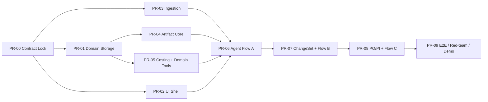

# 15｜实施路线图：按可运行纵向切片拆 PR

> 用途：让 3～4 位工程师 / Coding Agent 并行实现，不发生“每个模块都写完了，但无法跑通一单”的情况。  
> 状态：建议执行路径；这里列的是**交付顺序和依赖关系**，不是必须按自然周排期。

## 1. 先约定真正的 MVP Done

**输入**真实格式的测试询盘 / 供应商报价 / 客户变更 / PO，**输出**可编辑且真实导出的规格、成本、报价、PI/生产资料草稿；至少 3 份 Artifact 联动；价钱由确定性引擎计算；不允许绕过报价/生产门禁；所有来源、版本和 Run 可追踪。

如果时间不足，优先缩减“支持多少种工件”，不能牺牲版本保护、金额正确或权限边界。

## 2. 开发依赖图

## 3. 各 PR 的交付物与验收

### PR-00：合同冻结（所有子组先读）

**Owner**：技术负责人 + 产品 / 后端。  
**修改范围**：`contracts/`、`docs/`、共享 Pydantic DTO。  
**必须产出**：Case / Source / FactAssertion / ArtifactVersion / ChangeSet / Approval 的字段 Schema；Tool I/O Schema；API 与 Event 命名约定。

**DoD**：前端和 Agent 可用同一套 ID 与字段路径编写 mock，而不需要各自创造 `quantity` / `qty` / `piece_count` 三套名称。

### PR-01：Domain Storage + Migration

**Owner**：后端。  
建立 PostgreSQL 模型、Alembic 迁移、Case Scope 授权、Source 元数据、Artifact 不可变版本与 Job Events。

**DoD**：可以通过纯 API 创建 Case、保存 Source、创建 Artifact Version、查历史；重复写入有幂等保护；并发版本冲突返回 409。

### PR-02：Frontend Shell（并行开发）

**Owner**：前端。  
三栏工作台、资源树、AG Grid 成本表、Agent Panel（先读 Mock Events）、Diff/Review 组件与按钮状态。

**DoD**：从模拟响应编辑一行 Costing，产生 typed patch，而不是仅修改本地字符串。

### PR-03：Ingestion & Provenance

**Owner**：多模态 / 解析工程师。  
文件上传、EML、XLSX、PDF 解析、简单图片 VLM 描述、Source Locator、抽取候选。

**DoD**：German Backpack Fixture 的核心字段可被抽取，至少显示 PDF 页码或 Excel cell；不知道材料和尺寸时不会补全。

### PR-04：Artifact Versioning & Renderer

**Owner**：后端 Artifact 工程师。  
Canonical Schema、`create_draft`、字段 Patch、Diff、依赖规则与 `export_xlsx/docx/pdf`。

**DoD**：同一 Artifact 多版本不可篡改；工件真实导出并被二次验证；修改包装项可触发下游待重算标记。

### PR-05：Costing / Quotation / Gate Tool

**Owner**：领域工程师。  
`normalize_supplier_quotes`, `calculate_quote`, `create_quotation_draft`, `validate_artifact`；`QUOTE_RELEASE` / `SPEC_ADOPTION` / `PRODUCTION_RELEASE` 第一版。

**DoD**：Golden 数值 A=8.69、B=9.03、彩盒=9.21；缺新包装成本不能释放报价；旧审批对新版本不生效。

### PR-06：Agent Flow A

**Owner**：Agent 工程师。  
LangGraph 主 Runtime、持久 Checkpoint、工具调度、Job Event、需求→规格→报价纵向集成。

**DoD**：通过前端从真实格式测试文件完成 Flow A；刷新页面 Run 记录和交付物不丢。

### PR-07：ChangeSet / Flow B

**Owner**：Artifact + Agent + 前端联合。  
新 Source → 变更抽取 → 依赖分析 → Patch → Diff → 接受草稿 → 重新核价 → 版本校验。

**DoD**：客户仅修改包装时至少三份工件可见变更；缺成本先阻断，新成本导入后 8.69→9.21；旧正式版本保留。

### PR-08：PO/PI/Production Flow C

**Owner**：领域 + Agent。  
PO 解析对照、PI、生产指令/T&A 草稿、生产放行 Gate、交付 ZIP。

**DoD**：正确 PO 可生成可编辑草稿；错误 PO 必须差异提示；样品批准缺失时无法标为已放行。

### PR-09：联调与 QA

**Owner**：全员 + 产品验收负责人。  
三条 Flow、接口契约、并发/重试/越权、文件导出可视验收、演示脚本。

**DoD**：从空数据库 `seed-demo` 开始、可重复回放，未依赖预先手工修改数据库，负向用例可演示。

## 4. 按团队人数拆角色

| 角色 | 主任务 | 必须先共享的合同 | 易出现的冲突 |
|---|---|---|---|
| A：架构 / Agent | PR-00 协调、PR-06、PR-07 Agent 侧 | Tool I/O、Run/Event | 把业务审批写进 Prompt |
| B：后端 / Artifact | PR-01、PR-04、PR-05 | 领域 Schema、版本约束 | 直接修改已发布版本 |
| C：前端 | PR-02、PR-07 UI、PR-09 UI | Typed API、Editor Patch | 在客户端算钱或假装发送 |
| D：解析 / QA / 文档 | PR-03、Fixture、PR-09 | Source Locator、Expected Labels | 解析值无来源、实验案例靠写死 |

3 人团队：解析/QA 由 B 与 A 分担，但**业务验收数据集必须有人负责**，不能只让写代码的人自评。

## 5. 两种比赛时间条件下的 Scope

### 极短周期（例如只有 48～72 小时可用）

保底做：`Case → Upload → Extract Requirements → Costing → Quotation Draft → Packaging Change → 3 Artifact Diff → Export`。真实 PO/生产资料简化为**一份 PI Draft + 放行门禁**。

### 有完整开发窗口（例如 1～2 周）

做三条 Flow + 持久 Run/审核恢复 + 多文件/负向测试 + 真实导出美化。不要把多 Agent 自治/真实收发邮件当初期目标。

*以上是对团队研发投入的范围建议，不是对最终商业产品交付周期的承诺。*

## 6. 合并前 Checklist（所有 PR 都需要）

- [ ] 对照 PRD/Domain Contract，没有私自新增同义字段。
- [ ] 重要业务函数具有类型定义、异常语义和单测。
- [ ] 数据库写入有 Case Scope、幂等与版本条件。
- [ ] 输出文件是 Canonical Version 的真实渲染，并校验关键数据。
- [ ] 所有“已确认/已发布/已发送”与实际授权和证据一致。
- [ ] Agent 可报告 `needs_info`/`blocked`，而不是总是“成功完成”。
- [ ] 变更公开的 API/Schema 同步 Markdown 文档和前端 Client。

## 7. 开发指挥纪律

1. 先执行 PR-00，确定 Schema 主权；前后端 Agent 子组都复用这份合同。
2. 每个 PR 必须提供**可运行的最小垂直测试**，不能只提交空文件与 TODO。
3. 一个模块的完成标准应通过“谁消费它”来定义，例如 Source Parser 必须能被 `extract_requirements` 直接使用。
4. 不接受以截图或 LLM 文字证明真实文件已生成；必须可下载并解析核验。
5. 评委 Demo 用相同 fixture 回放，但测试时应额外提供未出现在 Prompt 的负向样本。
