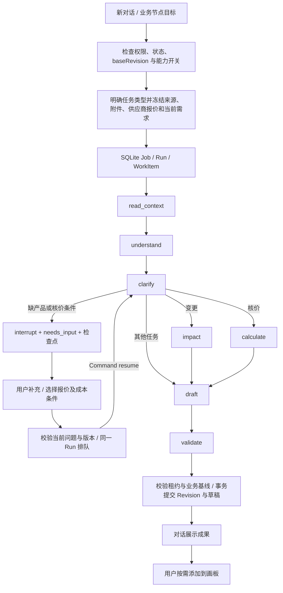

# 新版前端与后端适配 v1.1

日期：2026-10-31。代码基线：`e021cce` 合并的 `feat/qlc-frontend`，与此前后端实现 `8de5410` 对比。本说明记录本轮已实现的接口、状态和链路；长期产品目标仍参见 PRD、后端设计与完整 SOP 节点图。

## 1. 变化分析与处理

| 功能 | 合并后的变化与断点 | 本轮适配 |
| --- | --- | --- |
| 首页 | 统一 WorkHome，支持搜索、筛选、分页和最近标签；real 模式仍绕到旧工作台 | real/mock 均进入 `/inquiries/:id`；旧工作台保留为业务资料与审批入口，并能返回画板 |
| 询盘 | 左目录、React Flow 画板、资料标签；右侧对话、运行进度和成果收录 | 保留新版布局；笔记、布局、草稿、文件夹、标签和成果收录接入 SQLite；附件保存原文件 |
| AI 对话 | 前端已有澄清问答和取消，但后端没有实际恢复链路 | LangGraph `interrupt` 暂停、SQLite checkpoint、`Command(resume=...)` 恢复同一任务；取消支持空正文 |
| 资料引用 | 来源/附件版本展示已有，但 Worker 过去读取执行时全部证据 | 提交任务时校验权限并冻结输入；后续新增资料不进入已排队任务 |
| 知识库 | 新 Markdown Wiki 替代旧 Resources 页面，原先仅内存演示 | 创建、导入、阅读、下载和个人收藏接到服务；新版本保留旧正文；已引用版本禁止原地修改 |
| 资产库 | 公司/个人空间、任意文件、100 MB、预览、收藏 | 真实上传下载；公司共享、个人私有；所有新旧素材读取入口统一权限；收藏按用户隔离 |
| 技能市场 | 原先全静态能力目录 | real 模式读取后端能力目录，区分已接入、停用、规划中；Agent 停用后服务端拒绝运行 |
| 方案确认 | `accept_proposal` 曾被映射为报价任务 | 校验 proposalId/version 和确认依据，保存方案确认；不要求成本参数，不创建商业批准 |

## 2. 架构与数据边界

继续使用 React 19 / TypeScript / Vite / TanStack Query / React Flow，以及 FastAPI / SQLAlchemy / SQLite WAL / 独立 LangGraph Worker。模型抽取沿用 LangChain 的结构化输出；模型未配置时使用有限规则。财务金额使用 Decimal，核价不用模型计算。

新增后端模块：

- `workspace_api.py`：画板、Wiki、资产库、收藏及技能目录接口。
- `run_context.py`：明确任务意图、权限验证、版本输入清单、方案确认和澄清恢复。
- `worker.py`：从冻结输入构建上下文，消费 LangGraph 检查点，发布实际阶段事件，原子提交业务版本。

当前主库已有通用 `Item` 表，本轮新增 `canvas`、`canvas_file`、`favorite`、`run_event` 类型，复用 `resource`、`asset`；任务输入与恢复参数使用已有 Job/Run JSON payload。**没有新增表结构，本轮无需新增 Alembic 迁移**。启动仍执行既有迁移。未来规模扩大时，可把高频对象拆为专用表，不影响当前 HTTP 契约。

| 数据 | 范围 | 版本/保存规则 |
| --- | --- | --- |
| Canvas | 当前用户 + 工作空间 + Case | 独立 editVersion；布局和笔记修改不创建业务 Revision |
| Canvas 文件 | 当前用户 + 当前 Case | 不可覆盖原文件；下载同时校验 CaseAccess 与文件所有者 |
| Wiki | 工作空间共享 | 稳定 sourceId + 递增 version；新文档默认草稿 |
| 公司资产 | 当前工作空间成员 | 固定文件版本；可作为业务附件引用 |
| 个人资产 | 所有者 | 其他用户不能通过列表、旧 assets 接口或下载地址访问 |
| Favorite | 用户 + 文档/资产 ID | 设置绝对 starred 值，不修改共享资料 |
| 业务成果/Revision | Case 成员 | 沿用业务版本及审批门禁；画板收录不是批准 |

为了不把个人资料通过共享 Case 的 Revision 间接暴露给协作者，**个人资产不能直接进入业务 Run 的附件引用**。需要共享的资料，应由用户在公司资产空间上传；后台不会静默改成共享。

## 3. 实际 Agent 链路



`analyze/revise` 通过受限规则识别明确的核价、变更、打样、PI、生产资料包请求，默认走需求确认；它是可预测的 MVP 路由，并非通用自主规划器。显式 `/jobs` 继续使用既有 SOP `kind`。出运、财务和售后自动执行仍未接入，不会显示已完成真实业务。

任务只读取本次输入清单。所选知识资料保存版本 ID、SHA-256 和有界参考片段（每份最多 8,000 字符，总共 32,000）；它们作为参考附于成果，不当作客户事实。附件保存 blob ID/hash，不凭上传文件推断规格、成本或批准。供应商核价只使用明确选中的报价原件及用户填写的汇率、毛利率、数量。当前对话需求从上版候选字段继承，再叠加本次补充，避免第三轮对话退回原始数量。

`thread_id = job.id`。本轮对话澄清恢复采用 **同一 Job、同一 Run、同一 WorkItem**：这是相对于 v1.0 概念设计“每次恢复新建 Run”的具体实现选择。Worker 每次领取增加 lease_generation；工作进程重启后读取持久化 checkpoint；过期进程、取消任务不能提交业务成果。`pendingRunId` 让其他浏览器刷新后也能找回待回答任务。用户需先回答或取消当前澄清任务，才能开始另一项任务。

`Run.phase` 和 `completedPhases` 来自实际节点执行，`run_event` 持久化阶段轨迹。未经过核价/影响计算的任务不会把该阶段标记为完成。前端继续约 900 ms 轮询任务状态，当前未实现 SSE。

## 4. 新增/扩展接口

以下路径以 `/api/v1/workspaces/{workspaceId}` 为前缀；所有接口先验证 Cookie 会话和工作空间。错误沿用 `{error:{code,message,details},requestId}`。

| 方法与路径 | 输入 / 输出 | 关键校验 |
| --- | --- | --- |
| `GET /inquiries/{id}/canvas` | `{editVersion,state}`；首次 `0/null` | Case 权限、用户隔离 |
| `PUT /inquiries/{id}/canvas` | `{editVersion,state}` → 新 editVersion | 原子 CAS；陈旧版本 409 CANVAS_CONFLICT；schema=1；总正文 ≤3 MB |
| `POST /inquiries/{id}/canvas/files` | multipart file → WorkspaceFile | 每文件 ≤20 MB；服务端分配 ID，保留原文件 |
| `GET /inquiries/{id}/canvas/files/{fileId}/download` | 原文件 | 禁止跨 Case 或跨用户引用 |
| `GET/POST /library/documents` | `{items}` / `{title,folder,content}` | 正文 ≤2 MB UTF-8；新建草稿 |
| `POST /library/documents/{id}/versions` | `{baseVersion,title,folder,content}` | 所有者/管理员；旧版保留；冲突 409 |
| `PUT /library/documents/{id}/favorite` | `{starred:boolean}` | 用户独立收藏 |
| `GET/POST /library/assets` | `{items}` / multipart file,space,folder | 每文件 ≤100 MB；space 为 personal/company |
| `PUT /library/assets/{id}/favorite` | `{starred:boolean}` | 先检查资料可见性 |
| `GET /assets/{id}/versions/{v}/download` | 原文件 | 新旧资产库共用权限检查；不暴露磁盘路径 |
| `GET /skill-market` | `{items:[{id,tab,name,description,tags,includes,status}]}` | status=available/disabled/planned |

`POST /inquiries/{id}/runs` 扩展：

```json
{
  "baseRevision": 2,
  "action": "revise",
  "instruction": "请核算报价",
  "sourceVersionIds": ["knowledge_example:v1"],
  "assetVersionIds": ["asset_example:v1"],
  "inputRefs": ["evidence_example"],
  "selectedSupplierOfferId": "supplier_offer_example",
  "costInputs": {"exchangeRate": "7.2", "margin": "20", "quantity": 3000}
}
```

澄清通过同一路径提交 `replyToRunId` 和 `answers:[{questionId,value}]`。问题 ID 必须与当前 clarification 匹配；报价恢复还必须携带选中的 supplier offer 与有效成本参数。已完成、已取消、业务基线已变的任务不能再次恢复。报价缺参数可进入 needs_input；业务工作台的显式报价 Job 保持原有严格提交校验。

`accept_proposal` 必须携带 `{proposalRef:{proposalId,version},acceptanceEvidence}`。它只保存产品方向/方案确认依据；商业报价、样品、合同、付款保障、生产放行仍沿用独立审批记录。

材料草稿校验对应 Revision、回复草稿版本、来源与附件清单，禁止把无关资料 ID 塞进已固定的业务版本。

## 5. 前端保存与冲突处理

real 模式首次读取服务端画板成功后才挂载编辑区，不用空本地状态覆盖服务端内容。单个画板使用有序保存队列，250 ms 合并连续编辑；请求过程中新增的修改排在后面，前一响应不能覆盖后一笔输入。切换页面时继续提交待保存快照。

网络失败保留当前编辑，提供重试；409 版本冲突停止覆盖，提供草稿 JSON 下载，用户刷新后人工合并。未保存时关闭/刷新页面触发浏览器离页提示。只有服务端确认写入成果节点后，右侧才显示“已添加到画板”。这不是多人实时协同编辑，也不提供离线写回合并。

mock 模式继续保留合成示例、localStorage/IndexedDB 和静态资料库，用于原有前端演示测试；real 模式读取真实数据库，不自动注入这些示例。旧浏览器中的本地画板不自动迁移到真实业务空间。主题、侧栏和未发送输入等界面偏好仍可保存在浏览器中。

## 6. 验证与运行

启动方式不变：仓库根目录 `python dev.py`。运行前执行 `npm ci`，本次合并新增了 `@xyflow/react` 依赖。

后端回归覆盖：原报价/导出/变更/审批链；画板文件恢复与并发 CAS；跨用户私有资料、收藏隔离；旧资料版本可读取；来源冻结；Worker 重启后恢复同一任务；方案确认不生成商业批准；空正文取消；能力开关；多轮需求保持与对话变更路由。

前端单元测试增加保存队列与冲突保护；真实浏览器测试覆盖首页路由、画板/文件/成果刷新恢复、知识库/收藏/个人资产下载、技能目录、传统报价工作台和新对话报价澄清。`playwright.real.config.ts` 为每次运行生成独立 SQLite、checkpoint 和文件目录，不修改日常演示数据。

自动验证使用无模型密钥的规则模式，尚未证明真实模型供应商效果；二进制附件只保证保存、权限与版本固定，当前没有通用 OCR/多模态文件理解。知识检索目前为用户显式选择资料版本，尚未增加向量数据库。以上边界与界面上的待确认/草稿提示一致。

本轮验证记录：后端 7 项、前端单元 30 项、涉及页面的 mock 浏览器回归 24 项通过；真实服务的画板、资料库、新对话报价恢复和原报价工作台四条路径均通过（末条修正旧用例的默认项目假设后单独复验）。TypeScript 与生产构建通过。构建仍有主包体积超过 500 KB 的提示，未为比赛阶段额外展开拆包优化。
