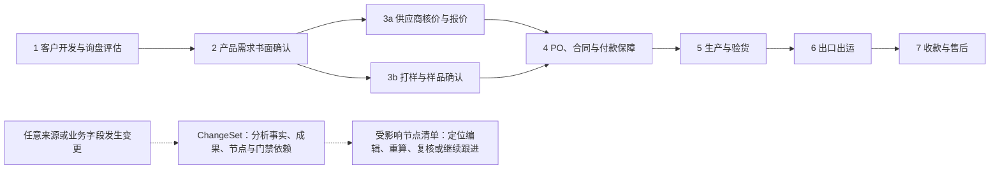
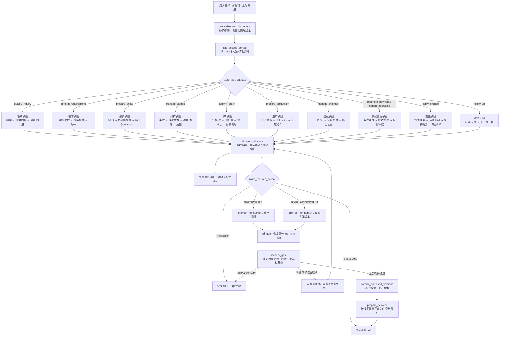
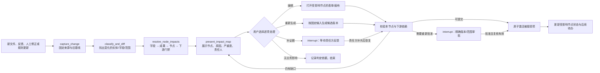

# NavoWork Agent 节点图 v1.0

> 最新运行链路见 [适配说明 v1.1](Frontend_Backend_Adaptation_v1.1.md#3-实际-agent-链路)：已实现持久化 interrupt/resume，对话补充恢复同一 Run；本文的完整 SOP 能力图仍为目标设计。

日期：2026-10-31  
状态：设计图，尚未实现  
依据：用户提供的《B2B 包袋出口外贸流程（业务 SOP）》与[后端详细设计](./TradeWorkbench_Backend_Design_v1.0.md#127-b2b-包袋出口-sop-顶层编排最新目标)

## 1. 业务阶段总图

一个 Case 贯穿客户项目；每次明确的业务目标创建一个 Job。以下箭头表示**下一阶段可发起新的 Job**，不表示 Agent 会跳过人工确认或在一条 Run 中自动执行整个订单生命周期。

阶段 3 的报价和打样可在同一已确认规格版本下并行推进；**报价批准不替代样品批准**。正式采购/生产资格必须汇合样品、订单、付款保障和供应商确认等独立条件。`follow_up` 是任何阶段都能发起的跟进 Job。

变更可以来自客户、供应商、内部人员、样品检查、订单文件、生产/QC、物流或付款记录，也可以是规则/模板更新。图中的受影响节点清单由依赖分析动态产生，不表示每次变更都会修改所有阶段。

## 2. 单个 Job 的 LangGraph 执行图

一个 Job 对应一条 LangGraph 线程（`thread_id = job_id`）。`Run` 是该 Job 的一次执行尝试；人工补证或审批后，创建新 Run，并从同一线程检查点继续。下图的 `route_job` 由服务端核验的 `job.kind` 决定；模型只能建议计划，不能改变授权和门禁。

`validate_and_stage` 的业务写入有独立幂等键；检查点与业务库分开提交，节点重放时必须复用已写入的结果。草稿输出发生在校验后；遇到不允许导出的硬错误时，仅展示缺口报告。图状态只存对象引用和简短摘要，金额、批准、合同内容和来源状态从业务库按固定版本读取。

## 3. 各业务子图的节点定义

| `job.kind` | 按顺序执行的主要节点 | 必须留下的成果/门禁 |
| --- | --- | --- |
| `qualify_inquiry` | `capture_lead → build_customer_profile → parse_inquiry → assess_project_risk → plan_follow_up` | 轻量客户档案、询盘摘要、信誉/真实性待核查项、跟进计划；不得无依据给出信用结论 |
| `confirm_requirements` | `extract_bag_requirements → reconcile_conflicts → draft_spec_pack → request_customer_spec_confirmation` | 材料、辅料、结构、LOGO、包装、测试和交期的 Spec；未知项保留未知，客户书面确认绑定版本 |
| `prepare_quote` | `build_supplier_rfq → parse_supplier_quotes → normalize_quotes → calculate_cost → draft_quotation → commercial_gate` | RFQ、供应商比较、成本表和报价草稿；成本用确定性 `Decimal` 计算，正式报价需商业批准 |
| `manage_sample` | `plan_sample → confirm_sample_terms → record_sample_build → inspect_sample → record_dispatch → collect_customer_feedback → sample_approval_gate` | 样品版本、费用/快递/时间、检查与寄样凭据、客户反馈；最终样品书面批准或有依据的免样批准 |
| `confirm_order` | `ingest_customer_po → compare_po_to_baseline → draft_contract_or_pi → collect_bilateral_confirmation → verify_payment_assurance → order_release_gate` | PO 差异、PI/合同草稿、双方同版确认和付款保障核验；缺任一必要条件不标记可正式采购/生产 |
| `prepare_production` | `prepare_production_pack → record_supplier_acceptance → track_production_events → evaluate_qc_evidence` | 生产资料/T&A、工厂接受和 QC 证据；首轮仅做资料准备，后续实况需真实凭据 |
| `manage_shipment` | `prepare_export_docs → verify_packing_and_invoice → reconcile_shipment → record_shipping_event` | 商业发票/装箱单/提单差异和出运证据；无承运或单证证据不显示已出运 |
| `reconcile_payment` / `handle_aftersales` | `record_payment_evidence → reconcile_receivable → track_claim_or_feedback → close_case` | 应收差异、催款草稿、售后/索赔证据；付款到账必须由财务/银行可信材料核验 |
| `apply_change` | `capture_change → classify_and_diff → resolve_node_impacts → build_maintenance_plan → present_impact_map → edit_or_regenerate → validate_affected_nodes → request_affected_approvals → activate_accepted_changes` | 任意有来源的业务变更 → 受影响节点、原因、编辑入口、下游成果/门禁与责任人；逐项处理后只激活通过校验的版本，不覆盖历史 |
| `follow_up` | `load_open_actions → draft_follow_up → assign_owner_and_due_date → record_feedback` | 待办、责任人、日期、邮件/消息草稿及客户反馈；无连接时不标记已发送 |

## 4. 通用变更与节点维护子图

变更是**已发生或提出的业务输入差异**，不限定于客户改规格或供应商改价格。它可指数量、材料、包装、样品结论、交期、付款条件、PO、验货结果、出运信息等；内部人工更正也须写明原因和责任人。收到变更后先创建带来源/版本的 `ChangeSet`，再映射到 SOP 中消费这些输入的节点。

影响结果至少返回：`nodeKey`、阶段、触发的字段/来源、旧/新值、直接或下游影响、当前成果版本、建议动作（编辑/重算/补证/重审）、阻断项、责任人、可打开的编辑目标。依赖由版本化的节点输入规则和实际成果依赖共同推导；模型可以补充“可能影响”候选与解释，但不能代替确定性依赖判定。没有影响也要保存判断依据。

**维护对象是当前 Case 的 SOP 执行实例**：例如新包装影响 Spec、成本、报价及样品/订单检查时，用户可跳转到这些节点修改候选版本。已完成节点不被直接改写，旧检查点不被整体倒带；系统创建新维护 Job/Run，更新节点的“待复核/待重算/已处理”投影。若要修改节点定义或全局门禁规则，则另行发布新的图/规则版本并评估现有 Case，不由普通业务变更自动改程序。

| 变更示例 | 直接影响节点 | 可能需要复核的下游节点 |
| --- | --- | --- |
| 客户更换包装 | `draft_spec_pack`、`plan_sample` | `calculate_cost`、`draft_quotation`、`compare_po_to_baseline`、`prepare_production_pack`；按版本及订单进度决定是否重审 |
| 供应商延长生产周期 | `normalize_quotes` 的交期字段 | 报价交期、合同交货日、T&A/出运计划；价格未变时不强制重算金额 |
| PO 修改付款条件 | `compare_po_to_baseline`、`draft_contract_or_pi` | `verify_payment_assurance`、`order_release_gate`；已批准商业条款可能需重审 |
| QC 发现尺寸偏差 | `evaluate_qc_evidence` | 生产整改、验货结论、装箱/出运门禁；不自动改客户原始规格 |
| 客户联系人电话更正 | `build_customer_profile` | `plan_follow_up`；通常不影响成本或样品批准，记录无影响原因 |

## 5. 人工门禁与实现顺序

| 门禁 | 必须核对 | 不满足时 |
| --- | --- | --- |
| `customer_spec_confirmation` | 客户书面确认精确 Spec 版本；关键 Unknown/冲突已处理 | 继续澄清或保留 Spec 草稿 |
| `commercial_gate` | 成本口径、贸易术语及港口、付款方式、MOQ、有效期、包装和交期经内部批准 | 报价仅为草稿，不对外正式发送 |
| `sample_approval_gate` | 定制款最终样品、LOGO/颜色/包装/验货标准和未关闭变更；免样须明确获批 | 不满足正式采购/生产资格 |
| `order_release_gate` | PO 与获批基线一致；合同/PI 双方同版确认；按约定核验定金/付款保障；工厂确认与重大变更状态有效 | 允许准备生产资料草稿，禁止标记可正式采购/生产 |
| `production_document_release` | 固定资料版本、批准人、来源/审批仍有效 | 不能正式放行资料；通过也不表示工厂已接单或开工 |

**开发顺序：** 首轮演示实现客户/询盘评估、需求、报价、样品台账与批准、PO/订单/付款保障核验、生产资料准备，以及跨阶段变更。生产进度/QC、出口单证/出运、收款/售后保留上述节点契约，在接入可信数据和人工授权后逐步实现。每个阶段先能输出可追溯草稿，再补相应的人工门禁；不靠模型推断批准、到账或生产事实。
