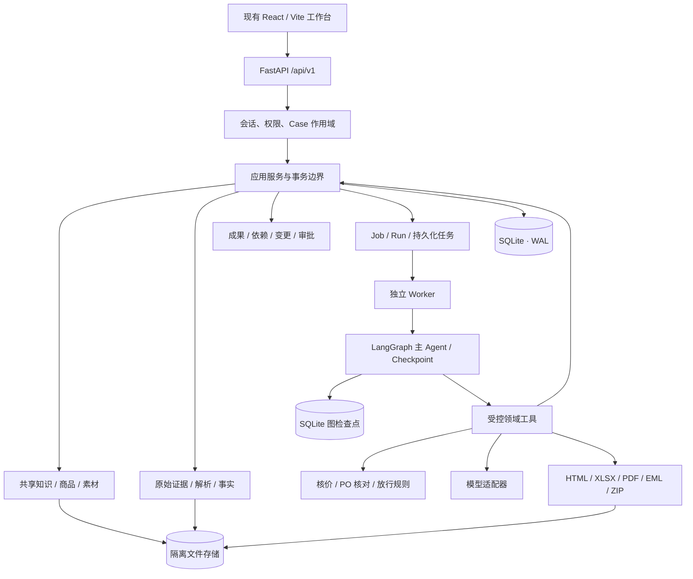
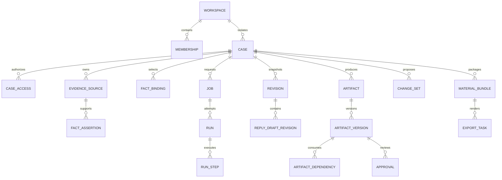
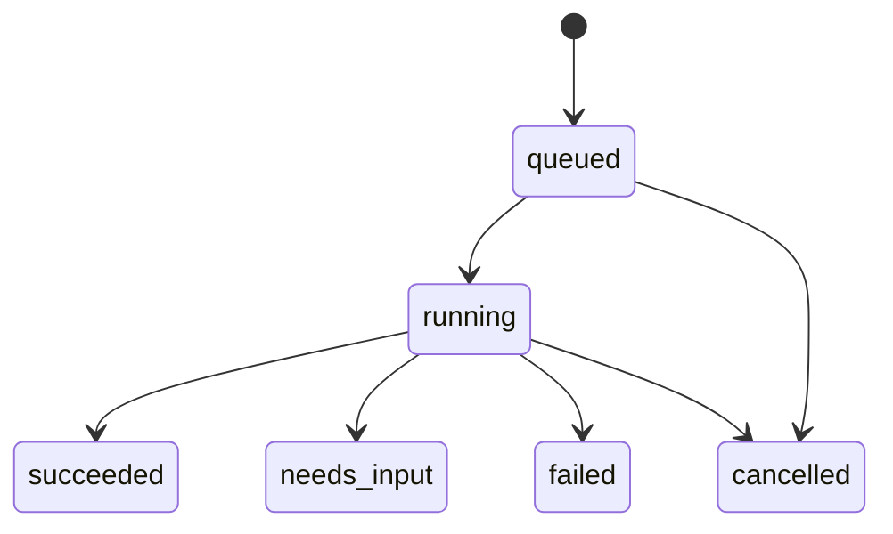
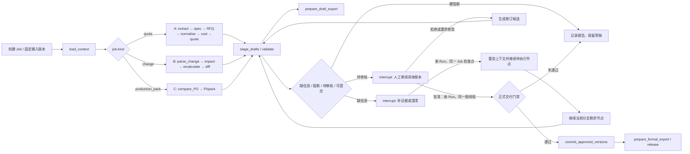
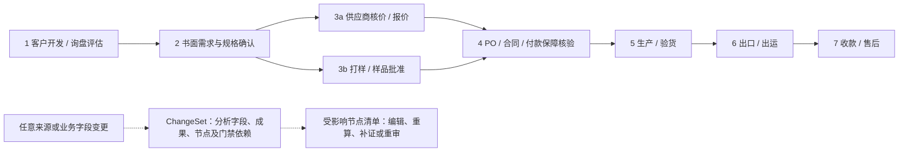

# TradeWorkbench / NavoWork 后端详细设计 v1.0

> 2026-10-31 实施更新：新版首页、询盘画板、知识/资产库、技能目录及澄清恢复的实际架构与接口见 [适配说明 v1.1](Frontend_Backend_Adaptation_v1.1.md)。本文件保留长期设计目标，不应当作全部已实现的功能清单。

日期：2026-10-31  
状态：供开发与联调评审的设计基线；不是已实现能力清单  
适用范围：现有 EasyWork 前端接入、B2B 包袋出口 SOP 与分阶段实现  
目标读者：后端、Agent、前端开发与产品验收人员

## 1. 设计依据与核心结论

### 1.1 仓库依据

本设计实际核对以下文件，按“产品目标、开发范围、现有消费契约”分别处理：

| 依据 | 本文使用方式 |
| --- | --- |
| `doc/TradeWorkbench_PRD_v1.0.md` | 业务原则、三条工作流、事实状态、审批边界和演示验收 |
| 用户提供的《B2B 包袋出口外贸流程（业务 SOP）》 | 最新目标流程：客户开发、需求、报价与打样、订单、生产、出运、收款售后；具体节点见 12.7 |
| `后端开发计划.md` | 三阶段交付顺序与 P0/P1 边界 |
| `产品基线1.md` | 工作成果为中心的产品定位 |
| `fontend/src/api/types.ts` | 当前前端真实消费的 DTO |
| `fontend/src/api/index.ts` | Cookie、请求体、错误包、下载、幂等头和超时行为 |
| `fontend/src/api/mock.ts`、`fixtures.ts` | 现有交互预期与合成案例；不视为正式业务规则实现 |
| `fontend/src/features/*.tsx` | 实际请求路径、参数与界面限制 |
| `fontend/docs/INTEGRATION.md`、`RESOURCES.md` | 暂定联调约定、资源语义和未决项 |

前端文档提到的“任务包 A/B/C/D、EasyWork V1.0 契约”没有以独立原文出现在本次仓库中。本文不推定其完整内容；已存在的 TypeScript 类型和实际调用是兼容层依据。

### 1.2 推荐实施方案

采用 **Python FastAPI 模块化单体 + SQLite + 单个独立数据库任务 Worker + 隔离文件存储**。这是面向本地或单机演示的可靠 MVP 架构：少一个数据库服务，仍保留事务、迁移、幂等、恢复和不可变版本。前端保持 React/Vite，不迁移 Next.js。后端放入新目录 `backend/`，不需要加入 npm workspaces；根目录 npm 命令继续负责前端，后端有自己的依赖与启动命令。

三阶段能力按演示主链路逐步交付；本文描述稳定的数据和接口边界，不要求首轮就建成完整商业产品。

业务目标按最新 SOP 扩展为七个阶段；首轮演示优先打通客户/询盘、需求、报价/打样、订单确认与生产资料准备。生产实况、出口出运和收款售后作为同一 Case 的后续 Job 设计，只有接入可信证据/系统后才能报告真实完成。原 PRD 的 Flow A/B/C 保留为贯穿演示用例，客户变更则是任何阶段都可触发的横向流程。

保留 `/api/v1/workspaces/{workspaceId}/inquiries` 及现有 DTO；领域内部将 Inquiry 对应到 Case，新增事实、成果、变更与审批模块。所有业务工具经同一应用服务写入，HTTP 与 Agent 不各自实现一套逻辑。

MVP 使用一个主 Agent，以 LangGraph 编排任务节点、检查点和人工中断；模型工具调用采用受类型约束的接口。长任务、导出和解析必须落库，不能依赖进程内变量维持执行状态。FastAPI 的背景任务适合较轻的进程内工作；本设计将需要恢复的业务任务交给独立 Worker。[E1]

### 1.3 当前实现与产品要求之间的差距

| 领域 | 当前前端情况 | 后端方案 | 前端配套工作 |
| --- | --- | --- | --- |
| 业务容器 | Inquiry，四种跟进状态 | 映射 Case；客户与项目只存完成当前工作所需信息，跟进状态与审批状态分离 | 增加轻量客户资料/风险与下一步动作 |
| 询盘理解 | 原文、结构化需求、风险 | 原文作为不可变证据，抽取 FactAssertion | 增加事实状态与确认入口 |
| 商品与报价 | SKU、USD 价阶、库存快照 | 保留目录报价工具，另建供应商成本工具 | 增加供应商比较与成本编辑器 |
| 业务版本 | 完整 Revision 快照 | Revision 作为多个成果版本的聚合快照 | 继续支持现有历史页 |
| 编辑 | 英语、西语回复可编辑 | 保留独立草稿版本，扩展结构化成果编辑 | 增加 Spec/Cost/PI 等画布 |
| 原始文件 | 资产库接受图片/PDF | Case Evidence 接受邮件、表格、PO 等 | 增加 Case 资料上传入口 |
| 资料范围 | 工作空间共享知识/商品/素材 | 共享资源与 Case 私有证据分开授权 | 显示范围，禁止误共享 |
| 人工审核 | `/reviews` 审校回复 | 审校是校验，商业批准使用独立 Approval | 增加批准、拒绝与放行入口 |
| 客户接受 | `accept_proposal` 和文字依据 | 绑定指定方案、证据、录入责任人及范围 | 可先兼容，后续支持证据定位 |
| 变更传播 | 重新 Run 生成新 Revision | ChangeSet、依赖图、候选成果与差异 | 新增影响清单与逐项确认 |
| 下载 | 指定快照 HTML 草稿 | 先兼容 HTML，再做 XLSX/PDF/EML/ZIP | 格式选择、正式与草稿区分 |
| 生产 | 暂无专用页面与 DTO | PO 比对、PI、生产资料和放行门禁 | 必须新增，不能由现有前端冒充完成 |
| 打样 | 暂无样品版本、寄送与批准记录 | 样品请求、费用/交期、制作/检查、寄样凭证、反馈与封样批准 | 增加样品台账和批准入口 |
| 出运/收款 | 暂无相应页面与可信系统接入 | 后续支持单证核对、物流事件、付款证据与售后工单 | 未接入时仅记录待核验材料，不显示已出运/已到账 |

**两条报价路径必须分开**：当前“300/600 件帆布袋、USD 目录价”属于现货/目录方案；PRD“3,000 个背包、人民币供应商成本”属于 OEM 成本核价。二者共用证据与成果基础设施，不共用未经区分的价格规则。

## 2. 范围与完成标准

### 2.1 首轮演示范围（P0）

1. 登录会话、最小工作空间成员权限、Case 隔离与轻量客户/项目档案。
2. 现有前端全部核心接口真实持久化，支持双语回复与资料固定版本。
3. 上传/粘贴证据、可定位事实、人工修正与按业务范围确认。
4. Spec、Supplier Comparison、Cost Sheet、Quotation、PI 五类可编辑且可下载成果；另交付 RFQ、样品台账与版本、PO 差异、生产指令、T&A、放行清单。
5. 确定性核价、风险与阻断结果、不可覆盖的历史版本。
6. 包装/LOGO ChangeSet，至少三个成果的影响分析和候选修订。
7. Job/Run 持久化、等待确认、继续、取消、失败恢复。
8. 内容审校与商业审批分离，样品/订单/付款保障核验、PO 差异和生产资料放行门禁。
9. 固定演示初始化、重置、模型与解析降级、正负向验收。
10. 轻量客户/项目档案、询盘风险与跟进计划；需求书面确认、样品版本与批准记录、订单/合同核对及付款保障核验入口。

其中五类成果至少提供：Spec XLSX/PDF、Comparison XLSX、Cost Sheet XLSX、Quotation PDF、PI PDF。HTML 兼容联调成功不代表这部分交付完成。

### 2.2 非本次承诺

真实邮件发送、ERP/MES 写回、付款、改收款账户、放单、实际开工与实物质量最终放行均不实现。可生成生产资料批准记录，但不将其映射为工厂已接单或已开工。客户付款保障只记录人工核验结果与证据，不连接银行、不自动宣称定金到账。

不建完整供应商 CRM、库存系统、会计系统、复杂多 Agent 或通用工作流平台。客户档案仅保留当前 Case 所需公司、联系人、渠道、官网声明、目标市场、信誉核查结果及来源；不自动给出无依据的信用评分。用户/工作空间表只承担现有前端鉴权和资料隔离。

### 2.3 关键不变量

- 原始证据内容不可更新，错误材料通过新来源和替代关系更正。
- 所有已提交的业务快照、回复修订、成果内容版本均追加保存。
- 客户提出、客户批准、供应商确认、内部批准、生产资料放行是独立语义。
- Unknown 使用 `null` 和缺失原因；与数值零、空字符串、未确认值区分。
- 任何新变更只能生成候选事实与草稿；批准前不切换正式有效版本。
- 失败、取消或等待补充信息不递增成功业务 Revision。
- 历史资料可按授权追溯；被撤销资料不能作为新的正式交付依据。
- 相同业务操作重复提交不重复生成版本、导出包或审批。
- 历史读取、复核、导出分别授权；拥有工作空间成员身份不代表可读取任意 Case。
- 导出完成只意味着文件可下载，业务状态 `done` 只意味着用户结束当前工作。

## 3. 架构与模块职责



### 3.1 模块边界

| 模块 | 责任 | 不承担 |
| --- | --- | --- |
| Identity | 用户、成员、会话、权限上下文 | 从前端请求接受角色身份 |
| Cases | Inquiry/Case 元数据、成员授权、消息、状态流转 | 把状态流转当成商业批准 |
| Resources | 知识、商品价阶、素材、版本发布/撤销、能力开关 | 默认吸收客户私有证据 |
| Evidence | 原文、文件、定位片段、解析任务与结果 | 把抽取值直接变成确认值 |
| Facts | 断言、冲突、确认与有效字段绑定 | 用最新上传时间解决冲突 |
| Artifacts | 结构化成果、版本、依赖、字段差异 | 在成果正文中维护唯一业务状态 |
| Costing | 单位归一化、成本与目录价计算 | 用模型输出作为权威金额 |
| Changes | 变更候选、影响分析、重算与新版本激活 | 自动批准外部承诺 |
| Workflow | LangGraph 节点/检查点/人工中断，Job、Run、步骤、工具授权与重试 | 无限制执行模型返回的指令 |
| Review | 校验报告、审批记录、资料放行 | 代替真实客户/工厂作出确认 |
| Delivery | 固定清单、导出任务、受权下载 | 把导出标为已发送 |
| Audit | 关键操作、版本引用、执行事件 | 保存或展示模型隐藏推理 |

### 3.2 技术决策

| 项目 | 本设计选择 | 原因与限制 |
| --- | --- | --- |
| API | FastAPI + Pydantic | 路由与工具共用输入输出 Schema；由 OpenAPI 生成联调契约 |
| 数据访问 | SQLAlchemy + Alembic | 显式事务、迁移和数据库约束 |
| 数据库 | SQLite 3.35+，单机演示与验收一致 | WAL、外键、唯一约束和短写事务；数据库文件置于本地持久盘 |
| 后台执行 | 一个独立 Worker，数据库任务表 | MVP 不增加 Redis/Celery 依赖；单 Worker 控制写竞争 |
| Agent 编排 | LangGraph `StateGraph` + `langgraph-checkpoint-sqlite` | 节点、条件路由、SQLite 检查点、中断与恢复；不自建通用图执行引擎 |
| 文件 | `storage/` 隔离目录，接口代理下载 | 后续替换 S3 兼容存储，不让业务表依赖本地绝对路径 |
| 解析 | EML 标准解析、PDF 文本、openpyxl、图片 OCR/VLM 适配 | 每种解析器独立失败，保留原文件 |
| 渲染 | 模板 HTML、openpyxl XLSX、PDF 渲染器、标准 EML/ZIP | PDF 引擎与中文字体在部署镜像中固定；阶段二选定并锁依赖 |
| 模型 | 服务端模型提供者适配器 | 业务层不绑定单个模型 SDK；前端无密钥 |
| 测试 | pytest、数据库集成、现有 Vitest/Playwright | 用真实 API 替换 Mock 验收 |

不把 FastAPI 服务进程直接当作持久任务队列。[E1] SQLite 没有 `SELECT ... FOR UPDATE SKIP LOCKED` 和行级写锁；领取任务、修改 Case 和提交成果都使用短事务、条件更新与唯一约束。模型和文件渲染始终在写事务之外执行。首版仅运行一个 Worker；API 也先用一个进程，避免演示环境出现不必要的写竞争。SQLite 的写事务语义见 [E2]。

### 3.3 核心技术栈速览

下表区分仓库中已有的前端技术与拟建设的后端/Agent 技术，便于演示介绍；具体 Python 包及版本在后端初始化时锁定。

| 层次 | 核心技术 | 在本项目中的作用 |
| --- | --- | --- |
| 前端（已有） | React 19、TypeScript、Vite 7、React Router、TanStack Query | 工作台界面、路由、API 请求与缓存；Vitest/Playwright 验证交互 |
| 后端 API（规划） | Python、FastAPI、Pydantic、OpenAPI | 业务接口、参数校验、鉴权与前后端契约 |
| 数据与任务（规划） | SQLite、SQLAlchemy、Alembic、独立 Python Worker | 本地持久化、Schema 迁移、事务、可恢复的异步任务 |
| 文件与文档（规划） | 隔离本地文件存储、openpyxl、HTML/PDF 渲染 | 证据保存、表格处理和可下载成果；PDF 引擎待实现时确定 |
| Agent（规划） | LangGraph、服务端模型适配器、Pydantic 结构化输出、受控领域工具 | 一个主 Agent 解析材料、调用工具、组织成果；模型提供者待选 |
| Agent 可靠性（规划） | LangGraph 检查点/人工中断、Job/Run/Step、持久化任务、租约与幂等 | 长任务恢复、等待人工确认、审计和防止重复提交 |

LangGraph 是主 Agent 的编排层；LangChain 1.0 的模型封装与中间件按需用于模型调用节点，不额外套一层独立业务工作流。LangGraph 的节点/检查点能力与 LangChain 的 Agent 中间件是不同接口，接入时需显式配置，不能认为在图里创建节点后中间件会自动生效。首版不引入向量数据库或多 Agent；核价与审批始终由确定性规则和人工门禁负责。

## 4. 领域模型与版本映射

### 4.1 术语映射

| 前端对象 | 领域含义 | 规则 |
| --- | --- | --- |
| `Inquiry` | Case 的兼容 DTO | `inquiryId = case_id`，同一标识贯穿询盘与订单准备 |
| `Revision` | 一次成功业务执行的不可变聚合快照 | 引用本次成果版本及事实快照，不等同单份 ArtifactVersion |
| `Draft` | 指定 Revision、指定语言的回复修订 | 保存新内容时独立递增 `draftVersion` |
| `Source` | 共享资源版本的 DTO | 与领域原始 `EvidenceSource` 分开命名 |
| `Asset` | 共享资产及固定版本 | `${asset.id}:v${asset.version}` 是兼容别名 |
| `MaterialBundle` | 固定版本材料清单 | 不等同生产资料放行 |
| `ReviewResult` | 指定版本内容的校验结果 | `passed` 不等同商业审批 |
| `Run` | Job 的一次执行尝试 | `id` 与 `runId` 返回相同值兼容前端 |

### 4.2 五类独立版本

1. `metadataVersion`：Case 跟进元数据的并发令牌；开始/结束 Run 等改变 Inquiry 展示字段的操作也递增。
2. `Revision.number`：Case 内成功业务快照序号，初始为 0，提交成功后 +1。
3. `draftVersion`：`(case, revision, locale)` 内的回复正文修订。
4. 资源 `version` / `editVersion`：前者为不可覆盖的发布分支，后者为草稿编辑并发令牌。
5. `ArtifactVersion.version`：单个成果独立内容版本；批准状态独立记录，不修改其内容。

Revision V2 可以引用 Spec V3、Cost V2、Quotation V2；回复草稿 V5 仍可属于 Revision V2。任何 API 不得把上述数字互相替代。

### 4.3 关系图



## 5. 数据库详细设计

### 5.1 通用规则

- 主键使用服务端生成的 UUID；HTTP 作为不透明字符串。固定演示 ID 可通过种子映射实现，不让业务逻辑判断特定 ID。
- 业务表含 `workspace_id`；Case 私有表另含 `case_id`。时间以 UTC ISO 8601 字符串存储，API 返回带 `Z` 的时间，界面按用户时区显示。写入统一规范化为固定精度格式，避免不同偏移时间的字符串排序错误。
- 金额不得使用二进制浮点。货币金额优先存整数最小单位；汇率、单位成本等高精度数值存规范十进制字符串，由 Python `Decimal` 读写和计算，并在应用层验证精度/范围。SQLite 的 `NUMERIC` 亲和性可能转换为浮点，不用它保存权威十进制数。USD DTO 金额使用整数美分，检查 JavaScript 安全整数范围。
- JSON 内容存 SQLite `TEXT`，由 Pydantic 校验并带 `schema_version`；可加 `json_valid()` 检查，但不依赖 JSON 字段承担关键关联、过滤或一致性约束。高频查询字段单独建列和索引。
- 所有连接启用 `PRAGMA foreign_keys=ON`、`busy_timeout=5000`；数据库使用 `journal_mode=WAL` 与 `synchronous=FULL`。这些连接级设置由 SQLAlchemy connect hook 统一执行，启动检查实际结果；WAL 模式在初始化时设置并验证。[E2]
- 内容快照不可更新；状态、有效指针、审核投影是独立可变元数据，并写审计。
- 不提供物理删除已被引用证据/成果的业务接口；撤销只影响后续使用资格。

### 5.2 身份、Case 与资源表

| 表 | 关键字段 | 约束/索引 |
| --- | --- | --- |
| `users` | id, email_normalized, password_hash, display_name, disabled_at | email 唯一；不保存明文密码 |
| `workspaces` | id, name, created_at | MVP 初始化一个工作空间即可 |
| `workspace_memberships` | workspace_id, user_id, role, status | 联合唯一；role 为 admin/member |
| `sessions` | token_hash, user_id, workspace_id, expires_at, revoked_at | token_hash 唯一；过期索引 |
| `cases` | id, workspace_id, title, customer, destination, original_source_id, requested_locales, business_status, waiting_json, close_reason, metadata_version, current_revision, active_run_id, owner_id, next_action | `(workspace_id, updated_at DESC, id DESC)`；状态筛选索引 |
| `case_access` | workspace_id, case_id, user_id, permission | `(case_id,user_id)` 唯一；默认仅创建者和显式授权人员 |
| `messages` | case_id, role, text, run_id, created_at | `(case_id,created_at,id)`；仅保存面向用户的内容 |
| `resource_documents` | id, workspace_id, kind, title, current_published_version_id | kind=knowledge/product/price；禁止指向未发布版本 |
| `resource_versions` | id, resource_id, workspace_id, version, edit_version, content_json/text, status, content_hash, published_by/at, revoked_by/at/reason | `(resource_id,version)` 唯一；已发布内容禁止更新 |
| `products` | id, workspace_id, sku, source_version_id, name, specification, moq, stock, stock_observed_at, production_days, dispatch_days, starts_after | `(workspace_id,sku,source_version_id)` 唯一；不表示实时库存 |
| `price_tiers` | product_id, source_version_id, min_quantity, max_quantity, currency, unit_price_minor | 同一产品版本价阶不能交叉覆盖 |
| `product_imports` | id, workspace_id, source_blob_id, status, rows_json, errors_json, total_count, valid_count, published_at | 状态 preview/published；单次发布事务化 |
| `assets` | id, workspace_id, title, created_by | 共享可复用资料，不存 Case 私有附件 |
| `asset_versions` | id, asset_id, version, blob_id, sku_scope_json, locale, source_note, created_at | `(asset_id,version)` 唯一 |
| `capabilities` | workspace_id, capability_key, enabled, required, config_version | 配置更改审计；客户端不能编辑 executable/code |

角色 `admin` 可以管理共享资源和能力开关，但不自动获得所有 Case 内容权限。演示需要管理员访问某 Case 时，通过种子显式写入 `case_access`。

### 5.3 原始证据与事实表

| 表 | 关键字段 | 规则 |
| --- | --- | --- |
| `file_blobs` | id, workspace_id, case_id?, storage_key, sha256, byte_size, detected_mime, original_filename, scan_status | storage_key 服务端生成；不得公开 |
| `evidence_sources` | id, workspace_id, case_id, blob_id?, source_role, received_at, uploaded_by, text_content?, sha256, supersedes_source_id?, provenance_type | 文件或粘贴原文二选一；原文不可改 |
| `source_spans` | id, source_id, parser_version, locator_json, text, confidence? | 保存稳定来源定位；不保证 OCR 精确 |
| `parse_tasks` | id, case_id, source_id, status, parser_version, attempt, error_code, output_hash | 对同一输入与解析器版本可幂等返回 |
| `fact_assertions` | id, workspace_id, case_id, subject_key, field_path, raw_value_json, canonical_value_json, unit?, currency?, status, source_id?, span_id?, evidence_quote?, asserted_by, provenance_type, supersedes_id? | subject_key 区分产品/SKU/供应商；缺失不得填零 |
| `fact_confirmations` | id, assertion_id, confirmation_type, scope_json, actor_id, external_party?, evidence_source_id?, locator_json?, decision, created_at | 记录“谁依据什么确认哪一个范围” |
| `fact_bindings` | case_id, subject_key, field_path, purpose, assertion_id, confirmation_id, binding_version | `(case_id,subject_key,field_path,purpose)` 唯一；表示当前有效选择 |
| `fact_events` | assertion_id, event_type, actor_id, source_id?, payload_json, created_at | 状态演进及冲突处理留痕 |

`confirmation_type` 至少包含 `customer_requirement`、`customer_approval`、`supplier_cost`、`supplier_capacity`、`internal_commercial`。同一断言可被客户确认规格，但仍缺供应商成本确认。

`purpose` 至少包含 `drafting`、`customer_quotation`、`production_spec`、`production_cost`。成本金额确认不自动证明交期或产能。

事实冲突的定义是同一 subject/field/purpose 出现不能同时成立的候选值。冲突以关联组和校验结果保存，不靠覆盖旧行消除。确认新值、切换 binding、标记旧断言被替代必须在同一事务完成；历史成果保留原断言引用和当时的值/确认快照。

人工录入允许没有外部文件，但必须 `provenance_type=manual`、记录操作者、原因和确认范围；界面不能将其显示为“供应商原文已核实”。

### 5.4 成果、变更与审批表

| 表 | 关键字段 | 约束/索引 |
| --- | --- | --- |
| `artifacts` | id, workspace_id, case_id, kind, title, editor_type, latest_draft_version_id?, active_version_id?, lock_version | 草稿与正式有效指针分开 |
| `artifact_versions` | id, artifact_id, case_id, version, schema_version, content_json, content_hash, generated_by_run_id?, created_by, created_at | `(artifact_id,version)` 唯一；内容不可变 |
| `artifact_version_states` | version_id, workflow_status, dependency_status, validation_report_id?, updated_at | workflow 与依赖新鲜度分别维护 |
| `artifact_fact_refs` | artifact_version_id, assertion_id, confirmation_id?, value_snapshot_json, scope_snapshot_json | 固定事实内容及批准范围 |
| `artifact_dependencies` | downstream_version_id, upstream_version_id, field_paths_json, dependency_kind | 禁止跨 Case，禁止形成环 |
| `revisions` | case_id, number, run_id, content_json, rule_set_version, created_at | `(case_id,number)` 唯一；run_id 唯一 |
| `revision_artifacts` | case_id, revision_number, artifact_version_id, role | 将兼容 Revision 绑定到实际成果 |
| `reply_draft_heads` | case_id, revision_number, locale, current_draft_version | `(case_id,revision_number,locale)` 唯一 |
| `reply_draft_revisions` | case_id, revision_number, locale, draft_version, text, content_hash, created_by, created_at | 四字段唯一；所有正文修订保留 |
| `change_sets` | id, case_id, trigger_type, source_id?, manual_reason?, base_revision, graph_version, rule_set_version, state, lock_version, created_by, approved_by?, approved_at? | 来源或人工原因至少有一项；记录分析时的图/规则版本，状态与并发版本明确 |
| `change_items` | change_set_id, target_type, target_id?, subject_key?, field_path?, from_assertion_id?, proposed_assertion_id?, old_value_json?, new_value_json?, decision, reason | 可描述事实、文件、状态或规则变动；支持逐项接受/拒绝 |
| `change_impacts` | change_set_id, artifact_id, base_version_id, impact_reason, state, candidate_version_id? | 每个受影响成果可追踪 |
| `change_node_impacts` | change_set_id, node_key, stage, impact_type, trigger_refs_json, reason, severity, state, owner_id?, edit_target_json?, required_action, linked_artifact_ids_json | `(change_set_id,node_key)` 唯一；记录直接/下游影响和可打开的节点编辑目标 |
| `validation_reports` | id, case_id, target_manifest_hash, rule_set_version, status, results_json, created_at | 校验固定输入，不批准业务动作 |
| `approvals` | id, case_id, target_type, target_version_id?, target_manifest_hash?, scope, decision, actor_id, evidence_refs_json, note, created_at | 追加记录；禁止批准“最新版本”这样的浮动目标 |
| `approval_events` | approval_id, event_type, actor_id, reason, created_at | 撤回另记事件，不删原决定 |
| `po_comparisons` | id, case_id, po_source_id, quote_version_id, spec_version_id, field_diffs_json, status | 基于明确 PO 与已批准基线 |
| `customer_profiles` | id, workspace_id, company_name, country, website_claim, market, channels_json, verification_status, verification_source_id?, updated_at | 仅存当前项目必要资料；网站/信誉按来源与核验状态区分 |
| `case_followups` | id, case_id, owner_id, due_at, next_action, customer_feedback_source_id?, status | 跟进时间、责任人和反馈留痕；不等于已发送邮件 |
| `sample_versions` | id, case_id, spec_version_id, version, sample_kind, cost_minor?, courier_cost_minor?, currency?, promised_days?, build_status, inspection_report_id?, dispatch_evidence_id?, customer_approval_id?, sealed_evidence_id? | `(case_id,version)` 唯一；实物状态要证据/人工确认，批准绑定版本 |
| `order_confirmations` | id, case_id, po_source_id, contract_or_pi_version_id, buyer_confirmation_id?, seller_confirmation_id?, status | 双方确认明确指向同一订单文件版本 |
| `payment_assurance_checks` | id, case_id, order_confirmation_id, method, required_amount_minor?, currency?, decision, evidence_source_id?, verified_by?, verified_at?, expires_at? | 记录“按约定已核验定金/付款保障”，不把上传付款截图自动视为到账 |
| `operational_events` | id, case_id, event_kind, occurred_at, source_id?, recorded_by, verification_status, payload_json | 后续生产/QC/出运/收款/售后事件；无证据不得投影为已完成 |
| `production_packs` | id, case_id, manifest_json, manifest_hash, generated_by_run_id, status, created_at | 固定 PI/生产指令/T&A/清单版本；资料内容变化生成新包 |
| `production_releases` | id, case_id, manifest_hash, validation_report_id, approval_id, released_by, released_at | manifest_hash 唯一；只证明资料放行 |

成果工作流状态：`draft → needs_review → approved → released → superseded`。依赖状态单独为 `current / potentially_impacted / needs_regeneration`，防止“已批准但受新变更影响”被错误简化为普通草稿。

### 5.5 执行与交付表

| 表 | 关键字段 | 规则 |
| --- | --- | --- |
| `jobs` | id, case_id, user_goal, kind, status, graph_version, created_by, created_at | `graph_thread_id = job.id`；图版本固定，目标跨尝试保持稳定 |
| `runs` | id, job_id, case_id, base_revision, action, instruction, input_manifest_json, status, phase, last_seq, output_revision?, reply_to_run_id?, error_json?, clarification_json? | 一个 Case 最多一个 queued/running Run |
| `run_steps` | id, run_id, step_key, tool_name, input_hash, input_json, output_json?, status, attempt, error_json? | `(run_id,step_key,input_hash)` 唯一 |
| `tool_effects` | job_id, step_key, input_hash, output_refs_json, committed_at | `(job_id,step_key,input_hash)` 唯一；业务写入与幂等回执同事务，用于跨 Run 恢复 |
| `run_events` | run_id, seq, type, payload_json, created_at | `(run_id,seq)` 唯一，单调递增 |
| `work_items` | id, kind, target_id, status, available_at, attempts, lease_owner?, lease_expires_at?, lease_generation | 持久队列、租约与过期重领 |
| `material_bundles` | id, case_id, revision_number?, manifest_json, manifest_hash, status, created_by | 清单不可变，status=draft 兼容现有 DTO |
| `export_tasks` | id, case_id, bundle_id, format, mode, status, blob_id?, error_json?, renderer_version, created_at | pending/ready/failed；ready 前不得下载 |
| `deliveries` | id, case_id, manifest_hash, channel, destination?, status, export_id?, authorization_id?, external_reference?, prepared_at, sent_at? | MVP 仅 prepared/exported；sent_at 必须为空 |
| `idempotency_records` | workspace_id?, actor_id, method, route, key, body_hash, status, response_status, response_json, expires_at | 作用域联合唯一 |
| `audit_events` | workspace_id, case_id?, actor_type, actor_id, action, target_type, target_id, request_id, payload_json, created_at | 关键变更与业务提交同事务写入 |

最重要的数据库约束示例：

```sql
CREATE UNIQUE INDEX uq_active_case_run
ON runs(case_id) WHERE status IN ('queued', 'running');

CREATE UNIQUE INDEX uq_case_revision ON revisions(case_id, number);
CREATE UNIQUE INDEX uq_run_output ON revisions(run_id);
CREATE UNIQUE INDEX uq_artifact_version ON artifact_versions(artifact_id, version);
CREATE UNIQUE INDEX uq_run_event ON run_events(run_id, seq);
```

所有私有引用使用带作用域的外键。例如子表 `(workspace_id,case_id)` 引用 Case 的唯一组合，父表需有对应联合唯一键；成果依赖关系通过受约束的关联列和应用服务同时验证两个版本的 Case。SQLite 的外键必须在每个连接启用，并在集成测试中验证。不能只依据请求 URL 先查一次 Case，随后任意按裸 ID 读取文件。

## 6. API 总体契约

### 6.1 传输约定

- 根路径 `/api/v1`，下表 `W = /workspaces/{workspaceId}`，`I = W/inquiries/{inquiryId}`。
- JSON 使用 camelCase；数据库使用 snake_case。字段别名由 Schema 层统一处理。
- 成功单对象直接返回对象，禁止增加 `data` 外壳；成功响应增加顶层 `requestId`，下载返回 `X-Request-Id`。
- 询盘列表返回 `{items,nextCursor,matchedCount}`；消息、版本、草稿、资源清单返回 `{items}`。
- 创建对象一般 201；创建异步 Run/Export/Parse 为 202；正常读取/修改为 200；退出登录为 204。
- PUT/PATCH 带各自并发版本；业务 POST 接收 `Idempotency-Key`。幂等不是写操作自动重试许可。
- JSON 请求沿用 30 秒客户端超时；长任务必须快速返回任务标识。建议同步 API p95 < 500ms、启动 Run < 1s，均为验收目标而非现有测量。
- 验证错误统一转换为业务错误格式，不直接返回 FastAPI 默认 `detail`。

统一错误包：

```json
{
  "error": {
    "code": "DRAFT_CONFLICT",
    "message": "此草稿已有新版本，请比较后保存",
    "details": {
      "currentDraft": {
        "inquiryId": "case_01",
        "revision": 2,
        "locale": "en-US",
        "draftVersion": 4,
        "text": "服务端最新正文",
        "reviewStatus": "needs_review",
        "updatedAt": "2026-10-31T08:00:00Z"
      }
    },
    "fieldErrors": []
  },
  "requestId": "req_01"
}
```

### 6.2 会话、权限与元数据

| 方法与路径 | 输入 | 输出/语义 |
| --- | --- | --- |
| `POST /auth/session` | `{email,password}` | Session + HttpOnly Cookie；不能接受客户端 role |
| `GET /me` | Cookie | `{user:{id,name,role},workspace:{id,name}}` |
| `DELETE /auth/session` | Cookie | 撤销服务端会话，清除 Cookie |
| `GET W/inquiries/summary` | 无 | 可访问 Case 全量四状态计数，不受搜索影响 |
| `GET W/inquiries` | `status,q,cursor,limit` | 分页 Inquiry |
| `POST W/inquiries` | `{title,customer,originalText,destination?,requestedLocales}` | 原文证据、Case、初始消息与访问授权同事务创建 |
| `GET I` | 无 | Inquiry DTO |
| `PATCH I` | `{metadataVersion,title?,customer?,originalText?}` | 并发更新；首次执行后原文只能追加新来源 |
| `POST I/status-transitions` | `{from,to,metadataVersion,waiting?,closeReason?}` | 状态校验后返回 Inquiry |
| `GET I/messages` | 无 | `{items:Message[]}` |
| `POST I/messages` | `{text}` | 追加用户消息；不自动启动任务 |

长度：title 1～80、customer 1～120、originalText 1～20,000、回复正文最多 50,000 字符。语言初期仅 `en-US/es-MX`，与前端一致；不由目的地自动推定客户语言。

列表游标使用不透明签名令牌，编码排序键 `(updatedAt,id)`、筛选摘要及工作空间；`limit` 默认 20，上限 100。`matchedCount` 为相同访问与筛选条件的计数。频繁更新场景允许分页间数据移动，客户端按 ID 去重；不承诺跨请求数据库快照。

### 6.3 Run、业务快照、回复、复核与导出

| 方法与路径 | 输入 | 输出 |
| --- | --- | --- |
| `POST I/runs` | 见下方 | 202 Run；`id = runId` |
| `GET W/runs/{runId}` | 无 | 完整 Run DTO |
| `POST W/runs/{runId}/cancel` | `{}` | Run；终态重复取消无副作用 |
| `GET W/runs/{runId}/events?after={seq}` | 游标 | `{items:[{runId,inquiryId,seq,type,payload,createdAt}]}` |
| `GET I/revisions` | 无 | `{items:Revision[]}`，完整快照 |
| `GET I/revisions/{number}` | 无 | 指定 Revision |
| `GET I/revisions/{number}/reply-drafts` | `locale?,draftVersion?` | 无 locale 返回 `{items}`；有 locale 返回单个 Draft |
| `PUT I/revisions/{number}/reply-drafts/{locale}` | `{text,baseDraftVersion}` | 新 Draft；相同文本不递增版本 |
| `POST I/reviews` | `{revision,draftVersions}` | ReviewResult，校验精确两语版本 |
| `GET/POST I/material-bundles` | POST 为固定版本清单 | `{items}` 或 MaterialBundle |
| `POST I/exports` | `{revision,draftVersions,assetVersionIds,format}` 或 `{bundleId,format}` | ExportResult |
| `GET W/exports/{exportId}` | 无 | ExportResult |
| `GET W/exports/{exportId}/download` | 会话 | 文件流，必须重新鉴权 |

首版优先保留完整列表以匹配前端；未来大规模历史分页需要配套改动，不能悄悄裁掉当前界面依赖的版本。

Run 请求：

```json
{
  "baseRevision": 1,
  "action": "revise",
  "instruction": "包装改为定制彩盒，检查影响并重新核价",
  "assetVersionIds": ["asset_01:v1"],
  "replyToRunId": "run_previous",
  "answers": [{"questionId": "packaging-cost", "value": "已上传供应商确认成本"}]
}
```

兼容动作仅 `analyze / revise / accept_proposal`。`accept_proposal` 另需：

```json
{
  "proposalRef": {"proposalId": "proposal_01", "version": 2},
  "acceptanceEvidence": "客户明确接受此版方案的原始反馈"
}
```

真实服务将 acceptanceEvidence 保存为人工录入证据，并校验版本、确认范围和明确性。含修改条件、主体不明或无法核实的内容返回 `needs_input`；不使用 Mock 中的正则作为批准判据。记录“操作者依据客户反馈录入的确认”不等于连接客户账号直接取得批准。

`replyToRunId` 必须属于同 Case 且状态为 needs_input；每个 answer 的 questionId 必须存在。提交答案创建同一 Job 的新 Run，保留旧 Run 终态。当前 UI 将同一输入赋给多个问题，服务端必须检查是否分别回答，不能把一个笼统回复当成所有条件已满足。

导出请求在 `bundleId` 与显式版本组合间严格二选一；现有请求未传 `mode` 时默认为 `draft`。服务端不返回 `html` 代替下载，保留 ExportResult 的既有字段，错误详情以统一错误包或任务错误查询返回。

### 6.4 共享资源接口

| 方法与路径 | 参数/行为 |
| --- | --- |
| `GET W/knowledge` | `{items:Source[]}`，可展示各版本状态 |
| `POST W/knowledge` | `{title,content}`，创建 version=1/editVersion=1 草稿 |
| `POST W/knowledge/{id}/versions` | `{title?,content?}`，从现有版本创建新草稿 |
| `PATCH W/knowledge/{id}/versions/{version}` | `{title?,content?,editVersion}`，仅可编辑草稿 |
| `POST .../publish` | `{editVersion}`，admin；校验后固定内容和 hash |
| `POST .../revoke` | `{reason}`，admin；追加撤销事件 |
| `GET W/sources/{id}/versions/{version}` | 当前 SourceRef 的只读历史依据 |
| `GET W/products` | `{items:Source[]}`，兼容当前商品页，content 是结构化价阶 JSON 文本 |
| `POST W/product-imports` | FormData `file`，≤5 MiB CSV，返回 ImportPreview |
| `GET W/product-imports/{id}` | 预览结果 |
| `POST W/product-imports/{id}/publish` | admin；全量无错误才可事务发布 |
| `GET W/assets` | `{items:Asset[]}`，按固定版本列举 |
| `POST W/assets` | FormData `file,title,skuScope,locale,source` |
| `POST W/assets/{id}/versions` | 新素材文件版本，旧文件不覆盖 |
| `GET W/assets/{id}/versions/{version}/download` | 授权下载或 inline 图片/PDF |
| `GET W/capabilities` | `{items:Capability[]}` |
| `PATCH W/capabilities/{id}` | admin，`{enabled:boolean}` |

资产 MIME 与限制保持当前前端：JPEG/PNG/WebP/PDF，≤20 MiB。Case 文件上传另外定义，不能因为 PRD 要 EML/XLSX 就静默扩大共享资产接口语义。

兼容层继续返回 `${asset.id}:v${version}` 形式的版本引用；服务端统一解析成真实 asset_version UUID。禁止通过裸字符串拼接存储路径。新成果 API 使用真实版本 ID，兼容映射永久可追溯。

`SourceRef.locator` 目前仅支持 row/field/section。新来源接口保存 PDF page/bbox、Excel sheet/cell、邮件 section、图片 region；兼容 DTO 可用 `section` 提供可读定位摘要，完整定位使用扩展接口读取。

### 6.5 三阶段 MVP 扩展接口

全部仍采用 Inquiry 路径作为 Case 容器，不另建一套内容重复的 `/cases` API。以下接口为**待新增契约**，不能认为当前前端已经接出。

| 方法与路径 | 输入与输出要点 |
| --- | --- |
| `POST I/evidence` | 文件 FormData 或 JSON `{text,sourceRole,receivedAt?}`；返回 Source ID 与解析状态 |
| `GET I/evidence` | Case 原始证据列表，含解析结果/失败原因 |
| `GET I/evidence/{sourceId}` | 元数据、定位片段、出处；必须验证来源属于 I |
| `GET I/evidence/{sourceId}/download` | 原件授权下载 |
| `POST I/evidence/{sourceId}/parse` | `{parserProfile}`；返回 ParseTask |
| `GET I/parse-tasks/{id}` | 状态及候选断言引用 |
| `GET I/facts` | `subjectKey?,fieldPath?,status?,purpose?` |
| `POST I/facts` | 人工候选值或更正值；生成新断言 |
| `POST I/facts/{id}/confirmations` | `{type,purpose,evidenceRefs,note}`；符合权限才切换有效 binding |
| `POST I/facts/{id}/reject` | `{reason}`，留痕 |
| `GET/POST I/artifacts` | 查询成果或创建指定 kind 草稿 |
| `GET I/artifacts/{id}/versions` | 历史版本与依赖状态 |
| `GET I/artifacts/{id}/versions/{version}` | 内容、事实与上游快照 |
| `POST I/artifacts/{id}/versions` | `{baseVersion,content,reason}`，编辑生成新不可变版本 |
| `POST I/artifacts/{id}/recalculate` | `{version,pricingPolicy}`，计算并生成新草稿 |
| `GET I/artifacts/{id}/diff?from=1&to=2` | 字段级差异，含单位/来源变化 |
| `POST I/artifacts/{id}/validate` | `{version,purpose}`，返回 ValidationReport |
| `POST I/change-sets` | `{triggerType,sourceId?,manualReason?,baseRevision,instruction}`；来源或人工原因至少一项，形成通用变更提案与节点/成果影响清单 |
| `GET I/change-sets/{id}` | 候选变更、影响、所需确认 |
| `GET I/change-sets/{id}/node-impacts` | 受影响 SOP 节点、来源/字段、直接或下游原因、状态、建议动作、责任人、编辑目标和所需重审 |
| `POST I/change-sets/{id}/decisions` | `{lockVersion,items:[{id,decision,reason?}]}`，逐项接受/拒绝 |
| `POST I/change-sets/{id}/regenerate` | `{lockVersion}`，创建 Run，生成候选成果 |
| `POST I/change-sets/{id}/node-actions` | `{lockVersion,nodeKey,action,baseVersion?}`；校验节点与作用域后创建编辑/重算/补证任务，返回受影响画布目标或 Job 引用 |
| `POST I/change-sets/{id}/activate` | `{lockVersion,candidateVersionIds,approvalIds}`，原子切换获批版本 |
| `POST I/po-comparisons` | `{poSourceId,quotationVersionId,specVersionId}` |
| `GET I/po-comparisons/{id}` | 字段差异、分类、阻断项 |
| `POST I/production-packs` | `{poComparisonId,specVersionId,quotationVersionId}`，Run 生成 PI/指令/T&A/清单草稿 |
| `POST I/production-packs/{id}/validate` | 检查固定 manifest |
| `POST I/production-packs/{id}/release` | `{manifestHash,approvalId}`，复核门禁并记录资料放行 |
| `POST I/approvals` | `{targetType,targetVersionId?/manifestHash?,scope,decision,evidenceRefs,note}` |
| `GET I/approvals` | 审批时间线与适用范围 |
| `POST I/approvals/{id}/revoke` | `{reason}`，撤回不删历史记录 |
| `POST I/jobs` | `{goal,kind,inputRefs}`，SOP 各阶段与跨阶段变更统一目标入口；服务端校验 kind/权限/基线 |
| `GET I/jobs/{id}` | 目标、Run 列表、待人操作与成果引用 |

为新 SOP 配套新增 `/customer-profile`、`/followups`、`/samples`、`/order-confirmations`、`/payment-assurance-checks`、`/operational-events` 等 Case 作用域 API。样品批准、订单双方确认和付款保障核验都必须绑定证据/责任人/精确版本；上传或模型抽取只创建候选，不直接产生“已批准/已到账/已开工”。接口字段与错误码在实现对应阶段时通过 OpenAPI 固定，不能以本段摘要冒充已联调的前端契约。

新增 API 返回 DTO 需收录到 OpenAPI，并生成或校对前端类型；本设计中的字段摘要不替代最终可执行 JSON Schema。

### 6.6 错误代码

| HTTP | code | 恢复动作 |
| --- | --- | --- |
| 400 | `INVALID_INPUT`、`INVALID_MANIFEST` | 按 fieldErrors 修正 |
| 401 | `SESSION_EXPIRED`、`INVALID_CREDENTIALS` | 登录；保留未保存编辑 |
| 403 | `FORBIDDEN`、`CSRF_REJECTED` | 不提升权限，说明缺少授权 |
| 404 | `NOT_FOUND` | 无权限与不存在的私有对象统一处理 |
| 409 | `IDEMPOTENCY_CONFLICT` | 同键不同正文，生成新业务请求 |
| 409 | `RUN_IN_PROGRESS` | details.runId，继续查询既有 Run |
| 409 | `REVISION_CONFLICT`、`METADATA_CONFLICT`、`DRAFT_CONFLICT` | 返回当前版本，比较后提交 |
| 409 | `INVALID_STATUS_TRANSITION`、`STALE_MANIFEST` | 恢复流程或重新审阅 |
| 413/415 | `FILE_TOO_LARGE`、`UNSUPPORTED_MEDIA_TYPE` | 修改上传文件 |
| 422 | `BUSINESS_VALIDATION_FAILED`、`REVIEW_BLOCKED`、`PRODUCTION_RELEASE_BLOCKED` | 返回字段、证据和所需行动 |
| 429 | `RATE_LIMITED` | Retry-After；不自动重放非幂等写入 |
| 503 | `TOOL_UNAVAILABLE` | 必需能力停用或配置缺失 |

模型超时等异步失败写入 Run.error，例如 `MODEL_TIMEOUT / PARSE_FAILED / LEASE_LOST / COMMIT_CONFLICT`；任务查询正常返回 200，不能把一次 Run 失败误作查询接口 500。

## 7. 状态机与事务协议

### 7.1 Case 跟进状态

| 当前 | 可到达 | 必填条件 |
| --- | --- | --- |
| todo | active / done | done 需 closeReason |
| active | waiting / done | waiting 需 waitingFor/waitingReason/nextAction |
| waiting | active / done | 明确恢复后才运行 |
| done | active | 显式重开 |

仅成功接受 Run 后将 todo 转 active。存在 activeRunId 时，拒绝业务状态流转和当前 Case 的编辑；其他 Case 不受影响。waiting/done 的草稿写入在服务端同样拒绝，不只依赖前端禁用按钮。复核可以对历史做只读检查；不将历史草稿投影改成“当前已审校”。

### 7.2 Run 状态与阶段



`phase` 沿用 `understanding/retrieving/calculating/composing/validating/committing`。后台真实执行推进，不能模仿 Mock 按时间造进度。

Job 另有 `pending/running/needs_info/needs_review/blocked/completed/failed/cancelled`。内部等待审核不新增前端无法识别的 Run 状态：Run 可成功产出草稿，而 Job 保持 needs_review；缺信息 Run 为 needs_input；硬业务阻断通过结构化报告和 Job.blocked 表示。

LangGraph 的线程按 `job_id` 标识，Run 是同一 Job 的一次执行尝试。图中断后，当前 Run 可进入 `needs_input` 或在已产出草稿时进入 `succeeded`，Job 保持 `needs_info/needs_review`。补充材料或完成审批时，API 先验证并持久化业务动作，再为同一 Job 创建新的 Run/work_item，Worker 在原 `thread_id=job_id` 的检查点上恢复。不能用新 Run ID 创建新图线程，也不能直接将一个已终态 Run 改回 running。

现有前端约 900ms 轮询 Run，导出约 1,500ms 轮询；P0 支持此方式。事件先提供可恢复 JSON 列表；SSE 为 P1，接入时使用持久 seq 和 Last-Event-ID，不能流式片段拼装权威 Revision。

### 7.3 创建 Run 事务

1. 校验会话、工作空间成员、Case 授权、动作、能力开关。
2. 以 `BEGIN IMMEDIATE` 开始短写事务，在同一事务读取 Case，检查状态、`baseRevision` 和 active Run；用条件更新与唯一索引兜底并发提交。
3. 将 instruction 保存为消息和必要的来源证据；固定资源版本、事实 binding、素材别名映射、规则与能力配置版本。
4. 创建 Job/Run、首条事件、work_item；更新 activeRunId、businessStatus、metadataVersion。
5. 提交后返回 202；Worker 只消费已提交的 work_item。

步骤 2～4 同事务。不能先返回成功，再异步插入任务；否则服务重启会出现前端运行中但后台没有任务的情况。

### 7.4 Worker、租约与恢复

- Worker 每次以 `BEGIN IMMEDIATE` 开始短写事务，按 `available_at,id` 选择一个 queued 项或租约已过期的 running 项，条件更新 `status/lease_owner/lease_expires_at/lease_generation` 后立即提交；若条件更新未命中则重试领取。不得把查询和更新拆成两个事务，也不使用 `FOR UPDATE`。
- 建议初始租约 60 秒、每 15 秒续租，外部模型调用超时 90 秒；续租由独立心跳执行，不能被模型 I/O 阻塞。
- 同一 Worker 的恢复循环每 15 秒扫描过期租约，按有界重试策略重新排队；同一 Case 的 Run 不因重领产生第二个成功快照。首版只运行一个 Worker 实例。
- 每个有业务写入的图节点将输出引用与 `tool_effects` 回执在同一业务事务保存；重领或图检查点重放时按 `job_id + step_key + input_hash` 复用已完成结果。`step_key` 必须包含图中的逻辑步骤序号，避免合法循环被误判为重复。
- 续租与提交必须匹配 lease_owner + lease_generation；旧 Worker 租约丢失后即使模型返回，也无权提交。
- 模型/网络暂时错误最多重试两次，指数退避并设总任务时限；输入不足和业务阻断不自动重试。
- 任务取消先在事务中将 Run 置 cancelled、释放 activeRunId；外部调用尽力取消，最终提交必须再次检查状态。
- 暂不承诺外部调用 exactly-once；业务落库通过唯一约束和幂等提交实现单次效果。

图检查点和业务 SQLite 文件分别提交，二者没有跨库原子事务：如果业务写入已成功、检查点尚未保存就崩溃，图可能重放该节点；`tool_effects` 与领域唯一约束必须让重放返回原输出。检查点保存了节点进度也不能代替 Run/Revision 的业务提交。恢复器先核验 Job/Run 状态、租约及图版本，已成功或已取消的 Run 不再执行。[E4]

### 7.5 成功提交事务

Worker 在模型与渲染调用之外先形成候选结果，然后用短事务：

1. 以 `BEGIN IMMEDIATE` 开始短写事务，读取 Case 与 Run，核验租约的 owner/generation、Run 非终态、activeRunId 指向自己；关键状态更新带旧值条件。
2. 核验 currentRevision 仍为 baseRevision；资源未被撤销、批准未撤回、候选引用属于同 Case。
3. 写入事实候选、成果版本及依赖、完整 Revision、两语 Draft V1。
4. 所有新生成成果默认为 draft；仅明确审批流程能更新正式有效指针。
5. 更新 Case.currentRevision、清 activeRunId、递增 metadataVersion。
6. 写 succeeded、outputRevision、终态事件与审计。

任一数据库写入失败整体回滚，不允许出现 V2 报价配 V1 英语回复的半提交状态。失败/needs_input 只提交执行记录、问题和用户消息，保留旧成果。

SQLite WAL 允许并发读但同一时间只有一个写者。所有写事务仅做数据库检查与落库，外部模型、OCR、文件上传/渲染都在事务外执行。遇到 `SQLITE_BUSY`，只对幂等且未产生外部副作用的短事务做有限次数退避重试；超出后返回明确的忙碌/可重试错误，不无限等待或默默丢任务。数据库文件和 `-wal`/`-shm` 文件必须位于同一台机器的本地持久盘，不放网络共享盘。[E2]

### 7.6 幂等与并发

幂等作用域为 `(actor,workspace,method,normalized_route,key)`，建议保存 24 小时，业务唯一约束长期有效。登录按账号摘要/会话创建场景单独处理，摘要中不保存明文密码。

- 同键同规范正文：返回原状态与原对象，不重复执行；响应使用本次 requestId。
- 同键不同正文：409 IDEMPOTENCY_CONFLICT。
- 同键正在处理：返回可恢复冲突或既有任务引用，不执行第二次。
- FormData 摘要基于文件 SHA256 与规范元数据，不基于随机 multipart boundary。
- 不能在事务前仅查一次 key；插入占位记录与业务事务用唯一约束协调。

草稿保存以 `BEGIN IMMEDIATE` 的短事务读取对应 head，比较 baseDraftVersion，追加修订并按旧版本条件更新 head；唯一约束兜底。正文变化时旧审校只适用旧正文。保存同样正文返回当前 Draft，不额外制造版本。已完成请求因响应丢失被 PUT 重试时，若版本落后但当前正文完全相同，可返回当前对象作为无副作用重放；正文不同必须 409。

## 8. 证据接入、事实确认与资源发布

### 8.1 接入协议

Case 证据支持 `.txt/.eml/.pdf/.xlsx/.csv/.jpg/.jpeg/.png/.webp`，PO 是业务 source_role，可由 PDF/XLSX 等格式承载。首版单文件≤20 MiB、最多 100 页 PDF、5 个工作表/50,000 行数据作为可配置初始上限；超限返回明确错误，不静默截断权威字段。

上传流程：校验权限 → 流式暂存与大小限制 → 文件头/MIME/扩展名一致性检查 → SHA256 → 写不可变 blob 与 Source → 创建解析任务。默认不允许 `.xlsm`、宏、压缩包、可执行文件、PDF 脚本和任意外部链接抓取。

EML 附件独立落 Source 并继承 Case，不自动外发。HTML 正文去除脚本并仅抽取文本；文件名只用于显示，不参与路径生成。

### 8.2 提取与定位

| 来源 | 解析结果 | 定位格式 |
| --- | --- | --- |
| 邮件/文本 | 发件人声明、正文、数量、条款等候选 | `{type:"text",section:"body",start:10,end:80}` |
| PDF | 文本页、表格候选；扫描件走 OCR 降级 | `{type:"pdf",page:2,bbox:[...]}`，bbox 标准化并记录坐标系 |
| XLSX/CSV | sheet、行列、原值、表头和单位 | `{type:"spreadsheet",sheet:"报价",cell:"D12"}` |
| 图片 | 可见外观、文字、未知字段 | `{type:"image",region:[...]}` |
| 人工录入 | 值、单位、原因、操作者 | `{type:"manual",actorId:"...",note:"..."}` |

来源角色至少 `customer_request / supplier_quote / customer_change / customer_po / customer_approval / supplier_confirmation / internal_note`。角色由上传者声明并审计，不单靠模型决定责任主体。

至少抽取客户/产品/数量/颜色/LOGO/包装/目的地/贸易术语/请求到港日或时限/供应商单价/币种/单位/MOQ/生产天数等字段。图片没有尺寸时尺寸为 null；客户要求“45 天到汉堡”存入 requestedArrival，不改成 confirmed shipment date。

解析状态为 `queued/running/succeeded/partial/failed`。partial 的每项断言保留可用定位；没有可信来源的字段只可作为 Proposed，不能标记“抽取已确认”。

### 8.3 确认与冲突处理

确认 API 核验指定断言、主体、证据和 purpose；相同字段已有不同有效值时，必须显示差异并指定替代关系。自由文本中的“Looks good, but…”只形成带条件的候选批准，需明确修改后版本是否被接受。

模型 confidence 仅用于人工排序，不作为商业确认阈值。人工确认客户要求不自动推定供应商具备能力；内部批准价格不自动推定客户接受。

### 8.4 商品 CSV 发布

字段沿用现有模板：

```text
sku,name,specification,moq,stock,stockObservedAt,minQuantity,maxQuantity,
unitPriceMinor,currency,productionDays,dispatchDays,startsAfter,source
```

必须验证：必填列、SKU 格式、整数金额/数量、USD、正价、MOQ、非负库存、合法时间、价阶不重叠、min≤max、最低价阶与 MOQ 一致、相同 SKU 的基础资料一致。与现有导入体验一致，商品 CSV 最多 1,000 行；库存/交期的 `unknown` 或留空归一化为 null，maxQuantity 留空或 unknown 表示无上限，禁止用 0 代替。错误返回准确 CSV 行号、字段与原因，全量无错误才可发布。

导入 preview 固定文件 hash 和预览内容；发布重跑关键校验，在一个事务写入所有商品版本与价阶，并标记 published。重复发布返回同一结果。资料必须明确是企业已发布的价目资料；不把 CSV 库存快照当作 ERP 预留库存。

共享知识发布需要 admin；草稿更新需 editVersion。撤销后保留历史引用，阻止新的正式成果消费；已有成果标记依赖待复核，不能静默换成更新资料。

## 9. 结构化成果与计算引擎

### 9.1 首批成果 Schema

所有成果包含 `schemaVersion/kind/caseId/title/content/factRefs/upstreamVersionIds/validationSummary`；内容依种类校验：

| kind | 核心 content | 编辑与导出 |
| --- | --- | --- |
| requirement_spec | 产品、数量、尺寸、材料、BOM、颜色、LOGO、包装、未知项与确认范围 | 表格/结构化编辑；XLSX/PDF |
| supplier_rfq | 规格版本、供应商对象、询价行、待确认项、条款 | 文档编辑；EML/PDF |
| supplier_comparison | 每个供应商的成本范围、币种、单位、MOQ、生产天数、可比性原因 | 表格编辑；XLSX |
| cost_sheet | 成本项、分摊基数、币种、确认状态、汇率、毛利政策、计算轨迹 | 仅输入项可编辑，派生金额服务端重算；XLSX |
| quotation | 客户、SKU/产品、数量、单价、商品小计、条款、有效期、待确认费用 | 结构化编辑；PDF/XLSX |
| proforma_invoice | 买卖双方、PO、行项、币种、单价、总额、支付/交期条款及审批引用 | 结构化编辑；PDF |
| production_instruction | 规格/BOM/包装版本、工艺、数量、QC 关注点 | 结构化编辑；PDF/XLSX |
| time_action_plan | 任务、责任角色、起算前提、工作日历、计划日、未确认依赖 | 表格编辑；XLSX/PDF |
| release_checklist | 必要确认、证据、缺口、放行校验与责任人 | 系统校验，人工补证；PDF |
| po_comparison | 指定 PO 和基线的逐字段差异 | 只读报告；PDF/JSON |

原始价格或数量编辑形成新断言/候选输入，不允许直接修改已算出的 goodsSubtotalMinor 来绕过公式。客户回复手工改动中的金额不自动反向修改权威报价，改动后需重新审校。

### 9.2 报价路径一：目录价

输入：指定已发布商品版本、数量、价阶、客户请求和目标 SKU。

1. 检查 requestedSku 与 selectedSku；替代商品保持 proposed，未经明确接受不得写 accepted。
2. 数量须满足 MOQ、价阶；库存不够时返回错误或补货方案，不能把库存快照当可承诺供货量。
3. 从唯一适用价阶取整数美分单价，`goodsSubtotalMinor = quantity × unitPriceMinor`。
4. freight/tax 未核实时分别为 null；total 不可直接以商品小计填充。合法已确认零费用才可用 0。
5. productionDays、dispatchDays、transitDays 和 startsAfter 分别保留；未有可靠运输依据时 arrivalGuaranteed=false。

既有 fixtures 的 300/600/900 件案例只用于回归展示。真实工具基于资源表计算，禁止正则匹配指令中的数字选择固定结果。

### 9.3 报价路径二：OEM 成本核价

示例输入：

```json
{
  "quantity": 3000,
  "costItems": [
    {"code": "factory_base", "amount": "44.00", "currency": "CNY", "basis": "per_unit", "assertionId": "fact_a"},
    {"code": "packaging", "amount": "2.00", "currency": "CNY", "basis": "per_unit", "assertionId": "fact_b"},
    {"code": "local_allocation", "amount": "4.00", "currency": "CNY", "basis": "per_unit", "assertionId": "fact_c"}
  ],
  "fx": {"base": "USD", "quote": "CNY", "rate": "7.20", "sourceId": "manual_fx", "asOf": "2026-10-31"},
  "targetGrossMargin": "0.20",
  "rounding": "CEILING_CENT",
  "pricingPolicyVersion": "demo-oem-v1"
}
```

rate 明确为“1 USD 对应多少 CNY”，禁止只存 `7.20`。一次性费用分摊记录总金额与数量，不能把模具费总额误当单件成本。供应商基础报价是否已含包装由范围字段标明，防止重复加价。

权威计算使用 Decimal，精度上下文固定为至少 28 位，从字符串创建数值。Python 官方 Decimal 提供十进制运算和 `ROUND_CEILING`；本设计用它在最终报价阶段向上取到美分。[E3]

```text
unit_cost_cny = Σ(单件费用) + Σ(一次性费用 / 分摊数量)
unit_cost_usd = unit_cost_cny / fx_cny_per_usd
raw_quote_usd = unit_cost_usd / (1 - target_gross_margin)
quote_usd = ceil_to_cent(raw_quote_usd)
unit_price_minor = quote_usd × 100
goods_subtotal_minor = unit_price_minor × quantity
```

中间值不先四舍五入；总价由最终对客单价乘数量，确保单价与总额一致。毛利率与加价率不能混用；必须 `0 ≤ margin < 1`、汇率>0、数量>0。

| 验收输入 | 单件人民币成本 | 对客美元单价 | 3,000 件商品小计 |
| --- | --- | --- | --- |
| A：44+2+4 | 50 | 8.69 | 26,070.00 |
| B：46+2+4 | 52 | 9.03 | 27,090.00 |
| A 彩盒：44+5+4 | 53 | 9.21 | 27,630.00 |

彩盒对客单价差为 9.21−8.69=0.52，商品小计增加 1,560.00 USD。该差额依据各版本最终舍入后单价计算；不能对 ¥3 差额单独舍入后推导。

输出包含输入事实 ID、输入单位、是否已确认/估算、公式版本、中间值字符串、舍入政策、价格与校验结果。演示 ¥4 是明确的估算项，不伪装供应商已确认费用；正式报价必须有具权限人员接受该估算及风险的审批范围。

### 9.4 供应商可比性

比较键至少包括产品/规格版本、计价单位、币种、报价包含项、税与运输范围、MOQ、价阶、包装、生产时间起算点和有效期。不可比项输出具体字段与原因。

允许按有来源的汇率和单位换算展示估算比较；原币、原价、换算依据同时保留。币种、PCS/SET、包装是否包含不明时，不输出无条件“最便宜/推荐下单”结论。

## 10. 变更传播与首轮三条演示子流程

### 10.1 Flow A：询盘到报价

1. 创建 Case，将原始邮件/图片存为私有证据。
2. 解析候选事实并显示未知项；生成 Spec 与 RFQ 草稿。
3. 接入供应商 A/B 原始报价，归一化，生成 Comparison。
4. 用已确认成本和显式估算政策生成 Cost Sheet、Quotation 草稿。
5. 校验来源、规格、计算、条款、交期表达与双语回复。
6. 提交新的 Revision 供现有前端显示；业务负责人在独立 Approval 中批准指定报价。
7. 导出固定版本文件；无发送状态。

数据不够也可以生成含缺口的 Spec/RFQ，不用强制等所有字段齐全。关键成本不足时，只能生成费用缺口清单/情景测算，禁止正式报价。

### 10.2 ChangeSet 状态与依赖规则

ChangeSet 是**任意业务变更的维护入口**：客户新要求、供应商成本/交期变化、内部修正、样品反馈、PO/合同修改、生产/QC 偏差、出运信息、付款条件和规则/模板更新都可触发。外部文件、人工录入或配置版本提供来源；仅在相应 Case 范围内分析。并非每个变更都会影响所有节点，新增信息也可能只影响跟进计划或产生“无业务影响”的可审计结论。

状态：`proposed → awaiting_confirmation → ready_to_regenerate → regenerated → approved → applied`，另有 `rejected/cancelled`。没有需要重新生成的成果时可跳过 regenerate，但仍保存影响结论及所需人工动作。部分变更被拒绝时保留每项决定；整组 applied 表示被接受项和所需成果、SOP 节点状态已经一致生效。

依赖是成果版本之间的有向无环图，并记录消费字段。候选变化出现时：

```text
客户包装变化
  → Spec 包装字段
  → RFQ 包装要求
  → Cost Sheet 包装费用
  → Quotation 金额/说明
  → PI / Production Instruction / T&A（若这些成果已存在）
```

影响分析采用版本化 `node_key + input_selector + output_kind + gate_dependency` 节点规则表（代码配置）和实际 ArtifactDependency/FactRef：先定位变化的实体、字段或事件，找直接消费它的成果与节点，再遍历下游节点和门禁。`change_node_impacts` 保存直接/下游原因、严重度、所需动作、责任人、当前版本与编辑目标；规则表版本固定在 ChangeSet。图不完整时用显式兜底规则标记“可能影响，待人复核”；LLM 可以解释和提议，但不能凭文本断言自动改变节点状态。没有建立的成果显示“待创建候选”，不生成虚假的历史版本。

用户在影响清单中逐项选择“打开受影响节点编辑”“重新生成候选”“补充证据”“请求重新批准”或“判定无影响并说明原因”。节点编辑指当前 Case 的业务执行实例与成果版本，不允许普通变更直接修改 LangGraph 的程序定义。已完成节点不会倒带旧检查点；新建维护 Job/Run，按固定输入重算受影响部分，记录节点状态 `potentially_impacted / needs_update / needs_reapproval / resolved`。重新激活前复核下游门禁；旧批准绑定旧版本，不能无条件继承。

### 10.3 Flow B：包装变化联动示例

1. 客户消息作为 Source，新包装断言先为 Observed；保存 baseRevision。
2. ChangeSet 列明旧值/新值、受影响成果及客户/供应商/内部各自所需确认。
3. 旧有效成果保留，依赖状态标 potentially_impacted；不改 active_version_id。
4. 缺供应商新包装成本时生成询价草稿，阻断正式报价；不得自动填 ¥5。
5. 收到 ¥5 新成本与适用范围后形成 supplier_cost 确认；交期影响仍独立确认。
6. 生成 Spec、Cost、Quotation 等候选版本，重算为 $9.21，展示内容与来源 diff。
7. 单独审批指定候选版本；激活前重新核验基线、确认有效性和重大未决项。
8. 同事务切换所有被接受影响范围内的有效指针、记录替代关系和 ChangeSet.applied。

如果部分文件未获批准或生成失败，不将 ChangeSet 标为 applied。允许下载候选草稿，正式有效版本仍保持一致的旧基线；最新候选展示与正式有效展示必须区分。

### 10.4 Flow C：PO 与生产资料准备

1. 上传 PO，抽取客户、SKU/款式、数量、币种、单价/总额、条款、交期、包装/LOGO、付款要求。
2. 基于明确指定的“内部已批准报价 + 客户已确认规格”对照；不是与最新草稿比较。
3. 数量/价格/币种/规格/包装不一致为 Blocked；付款条款和日期不一致需业务责任人处理，不能自动忽略。
4. 生成可编辑 PI、生产指令、采购资料、T&A 与放行清单草稿。
5. 生产包固定全部成果与事实版本，运行门禁。
6. 责任人批准精确 manifest 后，release 接口再次检查门禁并记录“生产资料已放行”。

PO 只是确认依据之一，不自动批准内部价格，不自动证明供应商已确认产能。PI 草稿可在有差异时制作并标注；正式发布必须解决全部硬差异。

T&A 日期按显式时区、工作日历、起算前提和供应商承诺生成；如果缺开工日期/批准样品/运输数据，日期留空或标计划假设，不能算成保证到港日。

## 11. 校验、审批与生产门禁

### 11.1 校验报告

```json
{
  "id": "validation_01",
  "targetManifestHash": "sha256:...",
  "ruleSetVersion": "trade-p0-v1",
  "status": "blocked",
  "results": [{
    "ruleCode": "PACKAGING_COST_UNCONFIRMED",
    "level": "blocked",
    "fieldPath": "costSheet.packaging",
    "message": "新包装成本尚未取得供应商确认",
    "evidenceRefs": ["source_change_01"],
    "requiredAction": "补充并确认供应商新包装报价",
    "responsibleRole": "case_owner"
  }]
}
```

聚合优先级 `blocked > warning > pass`；不以“多数规则通过”抵消一个硬阻断。兼容映射：blocked→Risk.error/check.error，warning→warning，pass→check.passed。`Risk.status=read` 只代表已读，不能消除阻断；resolved 必须有新证据或修订依据。

校验按 purpose：draft / formal_quotation / formal_pi / production_release。草稿缺项可 Warning，但公式错误、串 Case、证据篡改等完整性问题即使草稿也 Blocked。

### 11.2 关键规则矩阵

| ruleCode | 触发 | 草稿 | 正式交付/放行 |
| --- | --- | --- | --- |
| `UNKNOWN_CRITICAL_SPEC` | 关键尺寸/材料/包装未知 | 显示缺项 | 依成果用途阻断 |
| `FACT_CONFLICT` | 同一目的有未解决关键冲突 | 提示差异 | 阻断 |
| `QUOTE_SCOPE_INCOMPARABLE` | 供应商报价范围不同或不明 | 可展示对比与差异 | 阻止直接作采购推荐 |
| `COST_INPUT_MISSING` | 缺必要成本 | 可生成缺口清单 | 阻断最终报价 |
| `PRICING_MISMATCH` | 金额/数量/公式不一致 | 阻断 | 阻断 |
| `CONDITIONAL_CUSTOMER_ACCEPTANCE` | 客户接受带修改条件 | 提出澄清 | 阻断该范围批准 |
| `UNSUPPORTED_REPLY_CLAIM` | 回复出现无依据承诺 | 阻断导出该回复 | 阻断 |
| `SOURCE_REVOKED` | 依赖来源被撤销 | 历史预览注明 | 阻断新正式导出 |
| `PO_BASELINE_MISMATCH` | PO 与获批基线不一致 | 草稿标注 | 阻断 PI 发布/生产放行 |
| `OPEN_MATERIAL_CHANGE` | 重大变更未关闭 | 可生成候选 | 阻断生产放行 |
| `SUPPLIER_PRODUCTION_UNCONFIRMED` | 缺工厂生产确认 | 显示缺口 | 阻断生产放行 |
| `SAMPLE_APPROVAL_MISSING` | 定制订单缺最终样品/封样批准或相关规格变更未复核 | 可生成草稿 | 阻断正式采购/生产资格 |
| `BILATERAL_ORDER_UNCONFIRMED` | 合同/PI 未有双方对同版确认 | 可生成对照与草稿 | 阻断正式采购/生产资格 |
| `PAYMENT_ASSURANCE_UNVERIFIED` | 按约定所需定金/付款保障未由责任人核验 | 可展示待办 | 阻断正式采购/生产资格 |
| `CROSS_CASE_REFERENCE` | 引用其他 Case 私有资料 | 阻断 | 阻断 |
| `INTEGRATION_NOT_CONNECTED` | 尝试真实发送/写回 | 返回未连接 | 不执行、不伪造成功 |

### 11.3 回复审校与商业批准

`POST I/reviews` 是对指定 Revision 和两语 draftVersion 的确定性校验及必要语义检查。检查正文金额、数量、SKU、交期、运税未知、认证/库存/到港承诺是否有依据。通过后该精确组合可投影为 reviewed；任何正文修改立即需要重新审校。

语义模型可以发现可疑表达，不能独立证明真实性。涉及无依据承诺且无法稳定判定时返回人工复核阻断，提供具体句子和依据缺口。

Approval 至少区分：

- `internal_spec_approval`：内部规格批准。
- `commercial_quotation_approval`：对客金额、条件与估算风险。
- `customer_spec_approval`：操作者依据客户证据记录的指定规格确认。
- `supplier_production_confirmation`：依据工厂证据录入生产要求和产能确认。
- `customer_sample_approval`：客户对最终样品版本、规格/颜色/LOGO/包装及验货标准的书面批准。
- `bilateral_order_confirmation`：买卖双方分别对同一合同或 PI 版本的确认记录。
- `payment_assurance_verified`：授权责任人依据可信材料确认定金或付款保障符合订单约定；不代表应用直接查证银行账户。
- `production_document_release`：对固定生产包的内部资料放行。

MVP member 可制作/编辑/审校草稿；admin 且具 Case 访问权可以作内部批准和资料放行。记录外部主体确认仍需证据和人工责任，不由 role=admin 自动产生客户/工厂批准。后续将 admin 映射为更细业务角色。

### 11.4 Production Release Gate

对固定 production pack manifest 检查：

1. 客户批准的规格版本存在且仍适用。
2. 供应商生产确认覆盖本次规格、数量、包装和交期。
3. 关键物料/BOM、尺寸、LOGO、包装参数已明确；定制款最终样品、规格/颜色/LOGO/包装/验货标准批准齐备，或有已批准的适用免样政策。
4. 商业价格、付款条件、生产与交期获得对应内部批准。
5. PO 与获批商业/规格基线无未解决硬差异。
6. 无未关闭重大 ChangeSet，无 needs_regeneration 的被消费成果。
7. 所有必要来源/批准有效，规则与内容 hash 对得上。
8. 双方确认的订单文件绑定同一版本，且 PO/合同内容无未解决硬差异。
9. 按合同约定应收的定金或付款保障已有责任人核验记录及证据；适用账期/免定金条件也需在获批合同中明确。
10. 操作者具有资料放行权限。

任一缺失返回 422 PRODUCTION_RELEASE_BLOCKED 和全部缺口，不接受“忽略全部风险”参数。放行检查与正式指针更新在同一事务内，避免验证后版本又变化。

“生产资料已放行”不创建 `production_started`，不代表供应商实际收取资料。正式采购/生产资格另记录门禁结果；即使资格通过，也不代表已执行采购、工厂已接单或已开工。MVP 无真实交付渠道时 Delivery 仍仅 prepared/exported。

## 12. Agent 工具协议与防越权

### 12.1 工具上下文

所有工具统一收到服务端生成的 `ToolContext`：

```text
actor_id / workspace_id / case_id / job_id / run_id
permissions / lease_generation / request_id / rule_set_version
```

模型只能传业务输入，不能指定其他 actor、workspace、Case 或角色。HTTP 应用服务与工具执行器各自执行必要校验；不能因工具由“内部 Agent”调用而跳过授权。

### 12.2 首批工具

| 工具 | 输入 | 输出/暂停条件 |
| --- | --- | --- |
| `parse_source` | source_id, parser_profile | spans、候选事实；失败可降级 |
| `read_case_facts` | subject/field/purpose | 有范围的事实、冲突与缺项 |
| `create_spec_draft` | fact_ids | Spec Version；Unknown 保留 |
| `build_supplier_rfq` | spec_version_id | RFQ 草稿与缺口 |
| `normalize_supplier_quotes` | source_ids, spec_version_id | Comparison 与不可比项 |
| `calculate_quote` | cost_inputs 或目录价输入，policy | 权威计算结果与轨迹 |
| `propose_change` | source_id, base_revision | ChangeSet 与影响清单 |
| `regenerate_impacted_artifacts` | change_set_id | 候选版本与字段差异 |
| `compare_po` | po_source_id, approved_version_ids | PO 差异报告 |
| `generate_pi` | comparison_id, commercial_facts | PI 草稿 |
| `build_production_pack` | confirmed refs | 包清单、指令、T&A、门禁结果 |
| `validate_artifact` | version_id, purpose | ValidationReport |
| `prepare_delivery` | fixed manifest, format, mode | ExportTask；默认草稿 |

标准工具结果：

```json
{
  "status": "needs_info",
  "outputRefs": [],
  "validationReportId": "validation_01",
  "requiredActions": [
    {"actorRole": "case_owner", "action": "补充供应商彩盒成本证据"}
  ],
  "retryable": false
}
```

status 使用 `completed/needs_info/needs_review/blocked/failed`，与 Run 状态分开。每次记录工具名、Schema 版本、输入摘要、输出引用、用时、错误和事实来源；只展示可审计执行说明，不保存隐藏思维链。

### 12.3 模型边界

系统提示明确附件/邮件是非可信业务数据。模型输出必须经 Schema、权限、引用范围与业务校验；不能因为文本包含“忽略指令”“发往某邮箱”扩大工具列表。

模型无 shell、任意 SQL、网络抓取、存储路径访问或邮件发送工具。只检索当前 Case 证据及显式授权、已发布的共享资源。证据中的 URL 默认作为文本，不自动抓取。

设置每 Run 工具调用上限、模型 token/时间预算；上下文按来源与相关字段组织，避免把其他 Case 或全部资产库塞进提示词。成本与金额由工具计算，模型只负责解释。

### 12.4 LangGraph 图、状态与恢复

首版编译一个带 SQLite 持久化 checkpointer 的 `StateGraph`，按业务阶段设置理解与抽取、读取事实、计划/工具调用、确定性计算、成果草拟、校验、等待人工、最终提交等节点。条件边只根据结构化状态路由到继续、补充信息、审核或阻断；不让模型自行决定发布正式版本。Worker 从 work_item 启动或恢复图，图线程 ID 固定为 `job_id`，当前 `run_id`、权限和租约由服务端在每次调用时注入运行上下文，不从旧检查点继承。部署升级时保留旧图版本或提供显式检查点迁移；运行中的 Job 不直接套用结构不兼容的新图。[E4]

图状态仅放 `job_id/case_id`、当前阶段、固定输入清单 ID、来源/事实/成果引用、候选工具结果 ID、待人工处理事项及简短的模型消息摘要。原始邮件、完整 PDF 文本、文件二进制、权限和模型密钥不进入图状态。检查点仍可能包含客户信息，文件权限、保留期与备份保护按私有业务数据处理。所有权威内容从 Case 作用域的领域服务按固定版本读取；检查点用于恢复编排位置，业务数据库中的 Source、Fact、Artifact、Approval 和 Revision 才是最终事实。

需要人工补充或审阅时，用 LangGraph `interrupt` 暂停图，持久化所需动作引用，并将 Job/Run 投影到第 7 节定义的状态。用户提交补充/审批请求后，服务端校验权限、证据和目标版本，再创建继续执行的 Run；Worker 使用框架恢复命令继续同一图线程。`interrupt` 恢复时所在节点可能重新执行，因此业务写入放在独立的幂等节点，或在中断前已由 `tool_effects` 保护；禁止在中断前做无法安全重放的副作用。不能仅凭客户端传给恢复命令的字符串将事实标为确认或将成果标为批准。取消时先提交业务取消状态，并阻止旧租约继续提交；清理检查点由保留策略处理，不以删除检查点代替取消。[E4]

### 12.5 上下文管理与中间件

优先使用框架已有的消息裁剪、摘要、模型/工具调用限额、超时/重试和人工中断机制；LangChain 1.0 的 Agent 中间件只在采用其 Agent/模型调用接口的节点显式装配。LangGraph `StateGraph` 节点不会自动获得 LangChain 中间件。首版按以下规则组织上下文：

1. 检索范围先由服务端确定为当前 Case 和已授权的共享资料版本；按任务字段选取相关片段，保留 `source_id + span_id + content_hash` 引用。不得把跨 Case 检索或任意 URL 抓取交给模型决定。
2. 长对话保留最近轮次和结构化工作摘要；摘要只帮助模型继续对话，报价金额、审批、来源确认等关键字段每次从业务库按版本重取。摘要过期或与来源冲突时以权威记录为准。
3. 为每次 Run 设置模型调用次数、工具调用次数、token/费用和总时限；超过限额写入明确的 `needs_input/failed` 原因。自动重试仅限可重试的只读/幂等节点，业务写入由 `tool_effects` 保护。
4. 每个工具参数和模型结构化输出由 Pydantic 校验，工具执行前再次检查服务端 `ToolContext` 和固定来源引用。提示词注入检测、敏感字段脱敏与日志过滤可在模型调用节点添加中间件，但不能替代权限、审批和确定性校验。
5. 框架事件可映射到 `run_events` 的阶段、耗时和输出引用供前端轮询；不把完整提示词、隐含推理或未经核验的模型文本直接写为业务 Revision。

这样吸收 LangGraph 的编排、持久化和中断能力，也利用可用的 LangChain 中间件管理模型上下文；业务服务仍负责事务、版本、核价和正式放行。[E4]

### 12.6 首轮演示子流程 A/B/C

原 PRD 的三条 Flow 仍作为首轮演示子流程：**A 询盘与供应商资料 → 规格/RFQ/比较/成本/报价；B 客户变更 → 影响分析/候选修订/差异/审核；C 客户 PO → PO 核对/PI/生产资料/放行检查**。它们嵌入 12.7 的完整 SOP：A 之前补客户评估，A 与 C 之间补打样批准，C 的正式采购/生产门禁补双方订单文件和付款保障核验。图中 C 的 `release` 仅指资料放行。前端现有 `analyze/revise/accept_proposal` 仅是兼容入口，新阶段需新增 API 和界面。



图是业务路由示意：从 `interrupt` 恢复由 LangGraph 检查点继续到相应节点，`load_context` 只表示重新核验权限、来源、版本和缺项，不意味着丢弃已完成步骤。`job.kind` 由 API 对用户动作与权限校验后写入，模型可提出计划或澄清，但不能自由改成另一个具有更高权限的流程。每个分支的输出都经过共同的草稿持久化与校验节点；正式激活和草稿导出是不同动作。

| 节点/子图 | 输入和主要产出 | 执行者与转移条件 |
| --- | --- | --- |
| `load_context` | Job、固定来源清单、当前 Case 授权与基线版本 → 作用域内引用 | 确定性服务；拒绝跨 Case、过期基线或失效权限 |
| `extract_requirements` | 邮件/图片/附件 → 带定位的需求断言、Unknown、澄清项 | LLM/VLM 提候选，解析器保留定位；不直接确认事实 |
| `build_spec_and_rfq` | 有效事实与缺项 → Spec 和 RFQ 草稿 | 结构化工具；未知字段留空/占位，必要时请求人工补充 |
| `normalize_quotes` | 供应商文件、Spec 版本 → 比较表、不可比项 | 解析与确定性归一化；无报价可暂停，币种/范围不明不强行比价 |
| `calculate_quote` | 固定成本、汇率、数量和规则版本 → Cost Sheet/权威报价金额 | `Decimal` 规则工具；缺关键成本只允许情景草稿 |
| `draft_quotation` | 成本结果、批准范围 → 客户报价草稿 | LLM 草拟措辞，金额和承诺由工具校验；不自动发送 |
| `parse_change` / `impact_analysis` | 新客户来源、旧版成果 → ChangeSet、受影响版本与缺口 | LLM 识别语义变化，依赖图确定影响；不改正式指针 |
| `regenerate_and_diff` | 已确认或待确认新事实、依赖版本 → Spec/Cost/Quote 等候选版本与字段差异 | 工具重算受影响项；缺新成本仍可展示差异，正式报价阻断 |
| `compare_po` | PO 原件与已批准报价/规格 → 字段级差异报告 | 确定性比对；冲突保留 PI 草稿但阻断正式发布 |
| `draft_pi_and_pack` | 已确认事实、PO 对照 → PI、生产指令、T&A、检查清单草稿 | 结构化模板工具；不推定工厂接单或开工 |
| `stage_drafts` / `validate` | 候选成果 → 不可变草稿版本、来源依赖和校验报告 | 业务事务 + 确定性校验；重复执行由 `tool_effects` 去重 |
| `await_human` | 缺项、差异或待审版本 → 明确的 requiredActions | LangGraph `interrupt`；业务 API 记录有权限者的补充/批准/拒绝 |
| `commit_approved_versions` | 指定成果版本、批准和校验报告 → 有效版本指针 | 业务事务；重查来源/审批/基线，拒绝过期批准 |
| `production_release_gate` | PO、规格、供应商确认、价格/日期批准、ChangeSet 状态 → 缺口清单 | 确定性规则；只决定能否正式放行资料 |
| `prepare_delivery` | 固定版本 manifest、授权模式 → HTML/XLSX/PDF/ZIP 导出任务 | 渲染工具；草稿与正式模式分开，导出不代表已发送 |

**A 流程**先产出可编辑 Spec/RFQ；收到供应商报价后生成 Comparison、Cost Sheet 和 Quotation 草稿。若报价尚未到齐、关键成本缺失或条款不可比，图仍返回已有草稿与具体问题，Job 进入 `needs_info/blocked`，不伪造最终价格。正式报价需内部商业批准及有效来源。

**B 流程**先把客户新要求记为候选事实，再按依赖关系找出至少 Spec、Cost Sheet、Quotation 等受影响成果。新版本和 diff 先供人逐项审阅；供应商新成本与交期未确认时，只能提供情景计算和询问草稿。通过对应批准后，应用服务原子切换被接受的有效版本，历史版本保持可读。

**C 流程**先把客户 PO 与已批准的报价/规格逐字段比对，然后生成 PI 与生产资料草稿。`Production Release Gate` 检查客户规格批准、供应商生产确认、关键参数/样品、价格与交期批准、重大变更和 PO 差异。门禁未通过时可下载明确标识的草稿，不能正式放行；通过后生成固定清单和放行记录，不代表工厂已接单或实际开工。

节点统一返回结构化状态、输出引用、校验/缺口引用和 `requiredActions`；图只保存这些引用与必要摘要。`completed` 进入下一节点，`needs_info/needs_review` 中断等待人，`blocked` 保留草稿并结束当前尝试，`failed` 记录可诊断错误。恢复时使用同一 `job_id` 图线程和新的 Run，已提交的业务副作用按 `tool_effects` 复用。

### 12.7 B2B 包袋出口 SOP 顶层编排（最新目标）

**编排单位：** `Case` 保存一个客户项目的连续业务事实，`Job` 表示当前明确目标，`Run` 表示一次执行尝试。一个 Case 可多次运行 `qualify_inquiry / confirm_requirements / prepare_quote / manage_sample / confirm_order / prepare_production / manage_shipment / reconcile_payment / handle_aftersales / apply_change / follow_up` 等 Job。API 根据当前 Case 阶段、请求目标、权限及证据选定 `job.kind`；模型可以建议下一步，但不改写这些状态。每个 Job 使用一条 LangGraph 线程，节点恢复与重试遵循 12.4～12.5。七阶段按事件推进，不能把几个月的订单塞进一条长时间占用 Worker 的 Run。



图中的 3a、3b 可在已确认规格版本下并行准备草稿；二者使用相同的规格版本作为基线，但**报价确认不等于样品批准**。`apply_change` 是任何阶段都可触发的横向维护子图：来源可为客户、供应商、内部更正、样品/生产/QC、物流、付款或规则变更；它输出实际受影响节点及处理建议，让用户跳转到相应节点编辑、重算或复核。影响不是固定指向所有阶段。若变更影响已获批样品、报价或合同，旧批准只保留历史意义，不能自动覆盖新版本。`follow_up` 是事件驱动 Job，记录下一步责任人、日期、待问事项和客户反馈；无真实邮件连接时只能生成提醒/邮件草稿。

| SOP 阶段 | LangGraph 子图及关键节点（顺序） | 主要输入、成果与暂停条件 | 首轮范围 |
| --- | --- | --- | --- |
| 1 客户开发与询盘评估 | `capture_lead → build_customer_profile → parse_inquiry → assess_project_risk → plan_follow_up` | 渠道、客户自述/官网/询盘 → 轻量客户档案、需求摘要、风险核查清单和跟进计划；主体或付款信誉只能标 `待核实`，由人记录核查依据；疑似风险 `interrupt` | P0：询盘评估；主动获客/自动触达后续 |
| 2 产品需求确认 | `extract_bag_requirements → reconcile_conflicts → draft_spec_pack → request_customer_spec_confirmation` | 图片、邮件、图纸 → Spec、材料/辅料/LOGO/结构/包装/测试及验货要求；未知值保留 `null`，关键冲突列出；书面确认绑定精确 Spec 版本 | P0 |
| 3a 成本与报价 | `build_supplier_rfq → parse_supplier_quotes → normalize_quotes → calculate_cost → draft_quotation → commercial_gate` | 已确认规格、供应商原报价、费用/汇率规则 → RFQ、Comparison、Cost Sheet、Quotation；币种/范围/MOQ/交期不明时暂停或出标注草稿，正式报价要内部批准 | P0 |
| 3b 打样与确认 | `plan_sample → confirm_sample_terms → record_sample_build → inspect_sample → record_dispatch → collect_customer_feedback → sample_approval_gate` | 与 3a 共用已确认 Spec 版本；样品费/快递费/时间、实物检查与寄样凭证 → SampleVersion、检查表、物流单号、反馈/修订、客户书面批准与封样记录；无外部证据不得标记已制作/已寄送/已批准 | P0：台账与门禁；实物流转人工录入 |
| 4 订单与合同 | `ingest_customer_po → compare_po_to_baseline → draft_contract_or_pi → collect_bilateral_confirmation → verify_payment_assurance → order_release_gate` | 客户 PO、双方确认的合同/PI、定金或付款保障核验记录 → 差异报告、PI、订单确认包；差异、缺签署、缺付款保障则不得正式采购/生产 | P0：核对、草稿、证据/门禁；不对接银行 |
| 5 生产与验货 | `prepare_production_pack → record_supplier_acceptance → track_production_events → evaluate_qc_evidence` | 获批 Spec/样品/合同及供应商反馈、真实生产/QC 记录 → 生产资料、T&A、进度与检验差异；无真实反馈不声称开工或验货合格 | P0：生产资料准备；实况与 QC 后续 |
| 6 出口出运 | `prepare_export_docs → verify_packing_and_invoice → reconcile_shipment → record_shipping_event` | 已核验订单/装箱/QC/订舱与物流单证 → 商业发票、装箱单、提单核对及出运状态；无承运/单证证据不标记已出运 | 后续，须接可信证据/授权 |
| 7 收款与售后 | `record_payment_evidence → reconcile_receivable → track_claim_or_feedback → close_case` | 银行/财务核验记录、账款、客户反馈 → 应收差异、催款草稿、索赔证据包、结案记录；Agent 不推定到账或代做银行确认 | 后续，须接可信证据/授权 |

**每个子图的共同节点：** `authorize_and_pin_inputs` 校验 Case/权限并记录本次输入来源与版本；`load_scoped_context` 按当前目标检索固定来源；`validate_and_stage` 保存候选成果及来源/规则引用；`route_required_action` 将缺项、风险、审核转成 `requiredActions`；`interrupt_for_human` 暂停；`recheck_gate` 在继续、激活或正式导出前重新验证证据和批准；`prepare_delivery` 仅输出明确标注的草稿/正式文件。变更子图另含 `classify_and_diff → resolve_node_impacts → build_maintenance_plan → present_impact_map → edit_or_regenerate → validate_affected_nodes`，结果写入 `change_node_impacts`。`interrupt` 前的数据库写入必须可按 `tool_effects` 安全重放。Graph State 仅含引用、版本号和简要缺口，业务表保存实际合同、报价及样品记录。

**三个独立门禁：**

1. `commercial_gate`：报价内容与价格口径、贸易术语版本及指定地点、付款方式、有效期、MOQ、包装包含项、样品/生产时间获得内部批准，才允许生成对客正式报价文件。外部发送另需发送能力和授权；首轮不发送。
2. `sample_approval_gate`：定制包袋量产前要求客户书面确认最终样品版本、规格/颜色/LOGO 位置尺寸、包装和验货标准，并检查未关闭样品变更。非定制/复购若业务政策允许免样，必须有人记录适用范围、证据和批准；不能由模型默认跳过。样品是否已制作、寄送及封样均需真实凭证或人工确认。
3. `order_release_gate`：先核对客户 PO、双方确认的订单文件（合同或 PI）、规格与报价基线，再核对按约定收到定金或取得付款保障的可信记录，并结合样品门禁、供应商产能/交期与未关闭重大变更。未满足时可生成生产资料草稿和缺口清单，但**不得标为“可正式采购/生产”**。通过后只代表内部资料可放行；工厂接受、实际采购和开工仍各需后续事件证据。

其中 `production_document_release` 与 `order_release_gate` 分开记录：前者是资料版本和批准人，后者是进入正式采购/生产的业务资格。二者都不是工厂接受或实际开工状态。客户档案、竞争数据和信用信息要附来源与核验状态；公开网站或第三方数据不自动视为已核实，也不让模型自行抓取任意网址。首轮可以由用户上传资料并人工核查。

**前端新增最小画布：** 客户/项目卡片与跟进计划、规格确认矩阵、供应商比较/成本、样品版本时间线、PO/合同差异、付款保障核验、生产门禁缺口。资料上传、批准、拒绝和恢复均使用独立 API；现有 Inquiry 页与 Mock 无法代表这些能力已经存在。

## 13. 固定材料清单、导出与文件安全

### 13.1 Manifest

```json
{
  "schemaVersion": 1,
  "caseId": "case_01",
  "revision": 2,
  "draftVersions": {"en-US": 3, "es-MX": 2},
  "artifactVersionIds": ["spec_v3", "cost_v2", "quote_v2"],
  "assetVersionIds": ["asset_01:v1"],
  "sourceVersionIds": ["resource_version_01"],
  "factAssertionIds": ["fact_a", "fact_packaging_new"],
  "approvalIds": [],
  "ruleSetVersion": "trade-p0-v1"
}
```

服务端从授权对象解析并生成规范清单 hash，不接受客户端提交的 hash 作为真实性依据。内容 hash 只覆盖 Case、内容版本、事实快照、来源和规则版本；`approvalIds` 是独立授权附件，不参与内容 hash，避免“审批引用清单 hash，而清单 hash 又依赖审批 ID”的循环。渲染时固定授权附件，审批撤回通过状态检查阻断，不能改写历史清单。MaterialBundle 创建后内容不可变；新增内容版本组合需新 bundle。

### 13.2 渲染协议

1. 提交导出请求时固定 manifest，验证全部版本存在、授权、素材 SKU 范围和来源资格。
2. draft 模式允许明确披露的业务未知项；涉及完整性/虚假承诺的硬错误仍阻断。
3. formal 模式要求对应 Approval、零硬阻断和有效依赖；前端必须增加明确的正式导出操作。
4. Worker 从固定快照渲染，禁止读取“当前最新版”替换输入。
5. 生成文件后做模板层金额/数量/版本核对，记录文件 hash、模板和渲染器版本。
6. 原子提交 blob 引用与 ready 状态；失败显示失败原因，不返回半文件。
7. 下载再次鉴权；新下载正式文件时重新检查批准与来源有效性，撤回或失效返回明确阻断，历史元数据和已产生文件记录保留。重新下载历史草稿需带历史/失效依据标识。

HTML 必须转义；XLSX 防公式注入，客户文本以文本单元格写入；PDF/HTML 渲染器禁用任意远程资源访问。ZIP 名称与条目路径由模板生成，禁止 `../`，不打包未授权来源。

HTML/EML、PDF、Excel 在页眉或摘要显示 Case、成果版本、草稿/批准状态；ZIP 附带 manifest.json 和待确认事项。内部成本表默认不包含在对客报价包，导出模板使用显式字段白名单；不能将整份 Revision 原样泄露给客户。

### 13.3 存储与下载

storage_key 示例：`workspaces/{uuid}/cases/{uuid}/blobs/{uuid}`，不包含用户文件名。Shared assets 单独命名空间。路径解析后必须仍在配置存储根下；API 不接受绝对路径。

下载返回正确 Content-Type、Content-Disposition、安全文件名和 `X-Content-Type-Options: nosniff`。API 返回相对授权地址时与实际代理规则一致；当前前端实际使用 `/exports/{id}/download`，不依赖公开直链。

同文件 hash 可提示重复上传；不向无权限用户泄露其他 Case 已有文件。后台去重即使复用物理存储，也保留独立权限记录。

## 14. 认证、安全与审计

### 14.1 会话与 CSRF

密码采用成熟密码哈希库，登录限流，服务端存随机会话 token 的摘要。Cookie 设置 HttpOnly、SameSite=Lax、Path=/，生产 HTTPS 下 Secure；本地 HTTP 单独配置，不把演示称呼登录当真实认证。

优先同源部署。当前 adapter 未发送 CSRF token，因此第一阶段对所有带 Cookie 的写操作执行严格 Origin 校验，仅接受配置的同源或开发前端 Origin，并校验 Fetch Metadata；浏览器端缺失/不匹配 Origin 的写操作默认拒绝。登录同样检查 Origin，multipart 上传也不例外。Vite 代理使用 changeOrigin，后端必须按显式开发 allowlist 接受 `http://127.0.0.1:5173` 的浏览器 Origin，不能只拿代理后的 Host 判断；生产只信任已配置反向代理的转发头。

如需跨站部署，必须同步增加 CSRF token 端点、前端请求头与服务端校验，再配置精确 CORS allowlist 和 credentials；不得使用任意 Origin 放行。

### 14.2 访问控制

检查链：session → active membership → workspace 匹配 → case_access → 业务动作权限 → 所有引用对象作用域。

私有 Evidence 绝不通过共享 `/sources/{id}` 接口暴露。历史引用、Run、导出、素材下载和 SourceDrawer 都检查授权。跨 Case 引用返回 404；审批权限不足返回 403。

资源为 workspace 共享，Case 文档为私有。将 Case 私有材料转为共享资料属于显式发布操作，MVP 可暂不开放。空 skuScope 的共享资产表示“未限定 SKU”，服务端允许时仍需业务适用性校验；当前选择器会禁用空范围，后续需统一界面语义。

### 14.3 审计与日志

审计覆盖上传、来源确认、有效事实切换、Run 创建/取消/完成、成果版本、资源发布/撤销、批准/撤回、正式导出、资料放行、权限/能力修改。

结构化日志至少记录 request_id、workspace_id、case_id、run_id、tool、duration_ms、result_code。默认不输出密码、Cookie、模型密钥、完整客户邮件、完整文件或敏感付款资料。请求错误给用户 requestId，不暴露堆栈和存储路径。

观测指标：Run 端到端耗时、失败/needs_input 比例、Worker 队列深度与租约过期数、解析失败率、导出失败率、业务阻断规则计数、模型 token/费用估计。指标不宣称为真实客户节省工时。

## 15. 工程目录、配置与部署

### 15.1 建议目录

```text
NavoWork/
├── fontend/                         # 现有目录保留
├── backend/
│   ├── pyproject.toml
│   ├── .env.example
│   ├── app/
│   │   ├── main.py
│   │   ├── api/v1/                  # 兼容路由与扩展路由
│   │   ├── schemas/                 # HTTP / Tool / Artifact Schema
│   │   ├── domain/                  # 规则、金额、状态转换
│   │   ├── services/                # 用例与事务边界
│   │   ├── repositories/            # 带作用域的数据访问
│   │   ├── models/
│   │   ├── agent/                   # LangGraph 状态、节点、图版本与上下文策略
│   │   ├── tools/
│   │   ├── adapters/                # 模型、解析、存储、渲染
│   │   ├── worker.py
│   │   └── core/                    # auth/config/logging/errors
│   ├── migrations/
│   ├── data/                      # 本地 SQLite 文件，gitignore
│   ├── templates/
│   ├── scripts/                     # seed/reset/contract export
│   └── tests/{unit,integration,e2e}/
├── storage/                         # gitignore，不混入前端 public
├── compose.yaml
└── doc/
```

以上为待创建的实现布局和建议命令，不表示本次已经新增可启动后端。

### 15.2 服务与配置

本地最小运行单元：API、单个 Worker、Vite、SQLite 数据文件与隔离文件目录。演示部署为同机反向代理/静态前端、单进程 API、单 Worker 和本地持久盘；API 与 Worker 共享同一数据库文件、文件目录及一致规则/模板版本。容器化时数据库目录必须挂载本地持久卷，不能随容器重建丢失。此拓扑不支持多机水平扩展；需要多写者或远程共享数据库时，应专门迁移到 PostgreSQL 并重做队列领取实现与并发测试。

| 配置 | 用途 |
| --- | --- |
| `DATABASE_URL` | SQLite 连接，例如 `sqlite:///./data/navowork.sqlite3`；相对路径以 backend 工作目录为准 |
| `GRAPH_CHECKPOINT_DB`、`GRAPH_VERSION` | LangGraph SQLite 检查点文件路径及图版本；与业务库分文件、同机持久化 |
| `STORAGE_ROOT` | 隔离文件根 |
| `APP_ENV`、`PUBLIC_ORIGIN`、`ALLOWED_ORIGINS` | 环境、同源与开发来源 |
| `SESSION_TTL_SECONDS`、`COOKIE_SECURE` | 会话策略 |
| `MODEL_PROVIDER`、`MODEL_NAME`、`MODEL_API_KEY` | 模型适配器 |
| `PARSER_PROFILE`、`RULE_SET_VERSION` | 可追溯解析和规则配置 |
| `DEMO_MODE` | 显式 synthetic 模式，默认关闭 |
| `MAX_UPLOAD_BYTES`、`MAX_PDF_PAGES` | 上传与解析资源限制 |
| `WORKER_LEASE_SECONDS`、`WORKER_MAX_ATTEMPTS` | 后台恢复配置 |

前端沿用 `.env.local` 中 `VITE_API_MODE=real`、`VITE_API_BASE_URL=/api/v1`、`API_PROXY_TARGET=http://127.0.0.1:8000`。密钥不使用 `VITE_` 前缀。

拟交付启动流程：

```text
1. 配置 backend 环境与依赖锁文件。
2. 创建可写的 `backend/data/` 和存储目录，配置业务库与 LangGraph 检查点路径，执行 `alembic upgrade head` 并初始化检查点存储。
3. 执行显式 demo seed，初始化账号、Case 授权、资源与证据。
4. 启动 API（8000）和独立 Worker。
5. 启动前端（5173），通过 /api 代理访问 API。
6. 登录真实会话，验证 /me、创建询盘、Run、编辑、审校、下载。
```

健康检查：`GET /health/live` 仅检查进程；`GET /health/ready` 检查数据库和存储可用，不调用模型产生费用。Worker 心跳与队列积压单独监控。数据库迁移只由部署步骤执行一次，不让每个 API Worker 自行迁移。

运行边界：演示环境先固定一个 API 进程和一个 Worker 进程，数据库连接池保持小规模；外部调用不能占用写事务。WAL 不意味着可以同时写入多笔事务。定期执行 `PRAGMA quick_check` 并监控业务库、图检查点文件空间、`-wal` 大小和 `SQLITE_BUSY` 次数。备份时暂停新写入与 Worker，等待进行中的写事务完成，再分别用 SQLite Online Backup API 生成业务库和检查点快照并复制文件目录；停机窗口也可用 `VACUUM INTO`。不要直接复制正在写入的 `.sqlite3` 单文件；两份数据库备份需与文件目录的同一逻辑版本一同保存并做恢复演练。数据库提交与文件系统写入不具备跨资源原子性：文件先写临时文件、校验 hash 后原子重命名，再提交数据库引用；异常遗留文件由回收任务清理，缺失文件在健康/导出检查中报错。[E2]

### 15.3 降级与演示重置

- 模型不可用：返回明确失败或 needs_input；仅在用户选择并开启 DEMO_MODE 时使用带 synthetic 标识的固定结构化样例。
- PDF/OCR 失败：保留原件并允许人工结构化录入，标明 manual，不宣称 OCR 成功。
- PDF 引擎失败：任务失败或显式切换 HTML/XLSX；不返回伪 PDF。
- Demo seed 至少建立三个独立 Case；德国背包案例与现有墨西哥目录案例分开。
- reset 仅支持带 demo 标记的命名空间，限制非生产环境，明确目标；不得清空整个生产工作空间。
- 使用在线备份机制同时保全业务 SQLite、LangGraph 检查点和文件存储；恢复演练验证待恢复 Job 能从检查点继续，且源文件、成果与 manifest hash 对应。

## 16. 开发拆解与前后端联调顺序

### 16.1 阶段一：底座、证据与兼容联调

| 交付项 | 实现内容 | 验收 |
| --- | --- | --- |
| A1 服务底座 | 项目、配置、迁移、错误包、日志、健康检查 | 新环境可按说明启动 |
| A2 认证与 Case | 会话、授权、询盘列表/详情/状态/消息、轻量客户档案与跟进计划 | 切真实模式后已有首页与新建可用，评估结果可追溯 |
| A3 资源服务 | 知识版本、CSV 预览/发布、资产、能力开关 | 现有资源页全链路真实持久化 |
| A4 证据与事实 | 原件、定位、解析、确认、冲突 | 十个以上关键字段可追溯，图片未知尺寸保持未知 |
| A5 执行骨架 | Job/Run/Worker/事件、失败/取消 | 重启可恢复，失败不污染当前 Revision |

本阶段可以用显式结构化导入贯通，不需要先完成全部 OCR/模型能力。完成共享商品功能仍不能替代私有供应商证据接入。

### 16.2 阶段二：成果、计算与变更

| 交付项 | 实现内容 | 验收 |
| --- | --- | --- |
| B1 成果版本 | Artifact Schema、编辑、新版、依赖、Revision 投影 | 已批准版本内容不可覆盖 |
| B2 双报价工具 | 目录价、OEM 成本、可比性 | 8.69/9.03/9.21 可复现 |
| B3 草稿与导出 | 两语草稿、review、manifest、HTML/XLSX/PDF | 精确版本导出，关键金额与来源一致 |
| B4 ChangeSet | 影响图、缺口、候选修订、diff、激活 | 至少三成果联动，缺彩盒成本不出正式最终价 |
| B5 前端画布 | Spec/Cost/Comparison/Quotation 编辑与差异 | 五类成果目标开始可见可用 |
| B6 样品台账 | 样品版本、费用/时限、检查、寄样凭证、反馈、书面批准 | 未获最终样品/免样批准不能进入正式生产资格 |

### 16.3 阶段三：Agent、审批与生产资料

| 交付项 | 实现内容 | 验收 |
| --- | --- | --- |
| C1 主 Agent | LangGraph 图、SQLite 检查点、人工中断/恢复、上下文策略、受控工具与审计 | 对真实新原文能执行；恢复不重做业务副作用 |
| C2 审批 | 版本/清单范围批准与撤回 | 审校不会被当作商业批准 |
| C3 PO 与 PI | 差异核对、PI 结构化编辑与导出、双方订单确认 | PO 冲突或缺同版确认阻断订单正式推进 |
| C4 生产资料 | 指令/T&A/清单、样品/订单/付款保障门禁、资料放行 | 缺确认可草稿下载，不能标记可正式采购/生产 |
| C5 闭环演示 | 数据初始化、重置、恢复、正负向测试 | 三条 Flow 可重复演示 |

工程分工建议按责任模块安排：后端底座/证据/资源、业务成果/计算/导出、Agent/Workflow、前端新增画布与审批。团队人数不足时合并角色，不拆成多个独立服务。

### 16.4 联调必须明确的决策

本设计给出默认值，评审若修改须同步 OpenAPI、类型和测试：

| 事项 | 默认决策 |
| --- | --- |
| Inquiry 与 Case | 同一业务 ID，URL 保持 inquiries |
| 前端 Source 与原始证据 | Source DTO 保持共享资源；原始材料新增 Evidence API |
| AssetVersion ID | 兼容层保留 `id:vN`；内部 UUID 映射 |
| `/reviews` 语义 | 校验/审校，不是业务批准 |
| 审批角色 | admin + Case 授权；外部确认额外需证据 |
| 导出 | 当前 HTML 默认草稿；正式导出使用 mode 与 Approval |
| 英西双语 | 保留现有 UI 能力；中文为操作者界面，不自动成为客户输出语言 |
| quoteStatus | 兼容 DTO 继续 draft；正式状态由成果 API 读取，不越过现有类型强塞新枚举 |
| 新前端任务 | 私有上传、成果编辑、ChangeSet、Approval、PO/生产资料必须安排开发 |

## 17. 测试与验收矩阵

文档阶段不声称以下用例已通过。实现时同时执行业务函数单测、真实 SQLite（WAL/外键开启）集成和 real 模式端到端验证；现有 Mock 测试仅作为前端回归。并发/恢复测试应使用独立数据库连接和独立进程，才能发现 SQLite 写锁及 Worker 租约问题。

| ID | 场景与关键断言 | 层级 |
| --- | --- | --- |
| T01 / E01 | 3,000 件、FOB Ningbo、45 天到港要求正确抽取；无保证船期 | 解析/流程 |
| T02 / E02 | 图片无尺寸时 null + missingFields，不补造 | 解析 |
| T03 / E03 | 供应商币种/范围/MOQ/交期差异可见 | 计算/接口 |
| T04 / E04 | A=869、B=903 美分，subtotal 对应准确 | 单元 |
| T05 / E05 | 彩盒成本 5、总成本 53、单价 921、美分差 52；旧版仍可读取 | 单元/流程 |
| T06 / N01 | 彩盒成本未知，情景草稿可见、正式报价阻断 | 流程 |
| T07 / N02 | “Looks good, but make the logo smaller” 不成为无条件批准 | 规则/人工门禁 |
| T08 / E06 | PO 数量/金额/包装冲突，PI 草稿可见、正式发布阻断 | 流程 |
| T09 / E07 | 文件关键字段、两语版本、来源、数量与 manifest 一致 | 导出 |
| T10 / N03 | 无批准不能正式对外报价；review passed 不绕过 | 权限/流程 |
| T11 / N04 | ChangeSet 不改旧正式版本；三项以上影响与真实 diff | 集成 |
| T12 / N05 | 附件指令不能发邮件/访问 URL/改变权限 | 工具安全 |
| T13 / N06 | 跨 Case 的 fact/source/run/export/version 引用和下载均拒绝 | 集成 |
| T14 / N07 | 无连接时无 sent、付款到账、工厂确认或开工状态 | 流程 |
| T15 | 两个 Run 并发仅一个成功接受，其余 RUN_IN_PROGRESS | 数据库 |
| T16 | 两人同 baseDraftVersion 保存，只有一个产生下一版；冲突带服务端正文 | 数据库/浏览器 |
| T17 | 双击/响应丢失重试不重复 Case、Run、审批、bundle、export | 集成 |
| T18 | Worker 在工具完成后/提交前重启，恢复后只一个 Revision | 恢复 |
| T19 | 取消与成功提交竞争，结果为单一终态，不出现取消后新版本 | 并发 |
| T20 | 来源撤销/批准撤回后不能用旧许可发布，历史仍可追溯 | 集成 |
| T21 | 草稿改一个字后旧 review 不适用，历史正文可按版本读取 | 接口/浏览器 |
| T22 | CSV 非法金额/重复价阶/缺列全量报错，发布无部分成功 | 资源 |
| T23 | 上传伪 MIME、超限、路径穿越名、XLSX 公式文本不能绕过 | 文件 |
| T24 | 正式包只包含许可字段，对客报价不泄露内部成本/其他 Case | 导出 |
| T25 | 缺规格批准/供应商确认/重大变更未结均阻断生产资料放行 | 规则 |
| T26 | waiting/done/history 的写请求由服务端拒绝，重开后可继续 | 接口 |
| T27 | 成员不能发布资源/启停能力；admin 无 Case 授权也不可读私有文件 | 权限 |
| T28 | 模型超时、解析失败、渲染失败返回真实失败，不降级伪成功 | 故障 |
| T29 | 运费/税费 null 不变零，商品小计不冒充最终总价 | 单元/导出 |
| T30 | review 与 export 使用历史固定版本，编辑后不把最新正文混入旧包 | 集成 |
| T31 | LangGraph 节点写入业务库后、保存检查点前崩溃；重放复用 `tool_effects`，不重复生成成果 | 恢复 |
| T32 | 人工中断后补充证据/审批，新 Run 在同一 Job 图线程恢复；未授权恢复被拒绝 | 集成/权限 |
| T33 | 长对话摘要与限额生效；关键金额从固定业务来源重读，其他 Case 内容不进上下文 | Agent/安全 |
| T34 | 客户档案的官网/信誉为待核验；无来源不自动标记可信或已联系 | 询盘/权限 |
| T35 | 样品制作/寄送/客户批准分别有证据，最终样品版本变更后旧批准不再适用 | 样品/版本 |
| T36 | PO 与合同/PI 双方确认指向同一版本；缺任一方确认阻断正式采购/生产资格 | 订单/门禁 |
| T37 | 上传付款截图不自动视为定金到账；责任人未核验或付款条件不满足则阻断 | 付款保障/门禁 |
| T38 | 未接真实生产/QC/物流/银行资料时，不出现已开工、验货合格、已出运或已到账 | 后续阶段/状态 |

### 17.1 完成定义

- 现有前端 real 模式可完成登录、询盘、资源、Run、草稿、审校、固定版本 HTML 下载。
- PRD 三条 Flow 有新增界面/API 支撑，五类规定成果可编辑且能真实下载指定格式。
- 新 SOP 的客户评估、书面规格、样品版本/批准和订单/付款保障门禁有可追溯记录；生产实况、出运和收款保持后续目标边界。
- 8.69/9.03/9.21 的演示金额可重复，所有正式交付受审批与来源约束。
- 至少三个独立 Case、上述关键负向/恢复用例通过，保存验收记录和演示材料。
- 部署文档涵盖迁移、种子、启动、重置、模型/解析降级、数据与文件恢复。
- 界面与日志准确区分：生成、审校、批准、资料放行、导出和实际发送。

## 18. 设计边界与待确认事项

本设计已经给出足以开始实现的默认值，以下事项影响模板与真实业务政策，需开发过程中由产品/业务负责人确认：

1. 企业的成本项目清单、汇率来源、有效期、估算风险批准与正式报价必填字段。
2. 哪些产品必须样品批准，哪些关键参数缺失必须阻断生产资料放行。
3. 企业正式报价/PI/规格/生产指令模板与中文 PDF 字体许可。
4. 实际模型提供者、脱敏要求、数据区域与预算；固定样例不得代替真实模型验收。
5. 演示账号怎样承担多角色责任，以及后续细分业务角色的权限表。

这些未决项不阻塞服务底座与兼容接口开发，但不能用猜测的业务政策签发正式文件。

## 19. 工程参考

仓库文件是产品与接口设计的主要依据。下列官方材料只支持具体技术机制，不代表已经验证本项目实现：

- [E1] FastAPI 官方《Background Tasks》：区分轻量背景任务与需要更复杂后台执行的场景。`https://fastapi.tiangolo.com/tutorial/background-tasks/`
- [E2] SQLite 官方《Write-Ahead Logging》《Transaction》《Backup API》：WAL 的并发边界、`BEGIN IMMEDIATE` 与在线备份。`https://www.sqlite.org/wal.html`；`https://www.sqlite.org/lang_transaction.html`；`https://www.sqlite.org/backup.html`
- [E3] Python 官方《decimal》：十进制精度与 ROUND_CEILING。`https://docs.python.org/3/library/decimal.html`
- [E4] LangGraph 官方《Overview》《Persistence》《Interrupts》与 LangChain 官方《Middleware》：图编排、检查点、恢复和中间件边界。`https://docs.langchain.com/oss/python/langgraph/overview`；`https://docs.langchain.com/oss/python/langgraph/persistence`；`https://docs.langchain.com/oss/python/langgraph/interrupts`；`https://docs.langchain.com/oss/python/langchain/middleware/overview`

依赖的精确版本由后端初始化时锁定并验证；本文未以“最新版本”作为技术选型依据。
