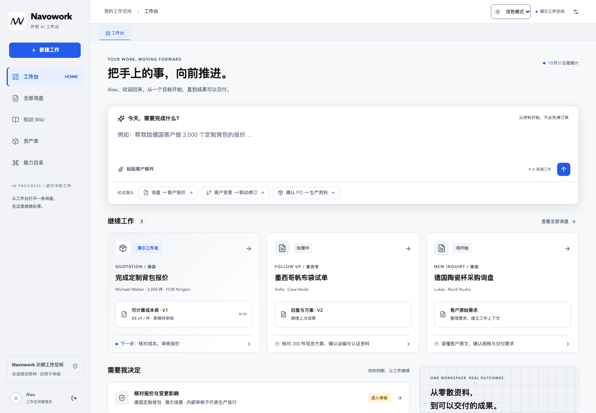
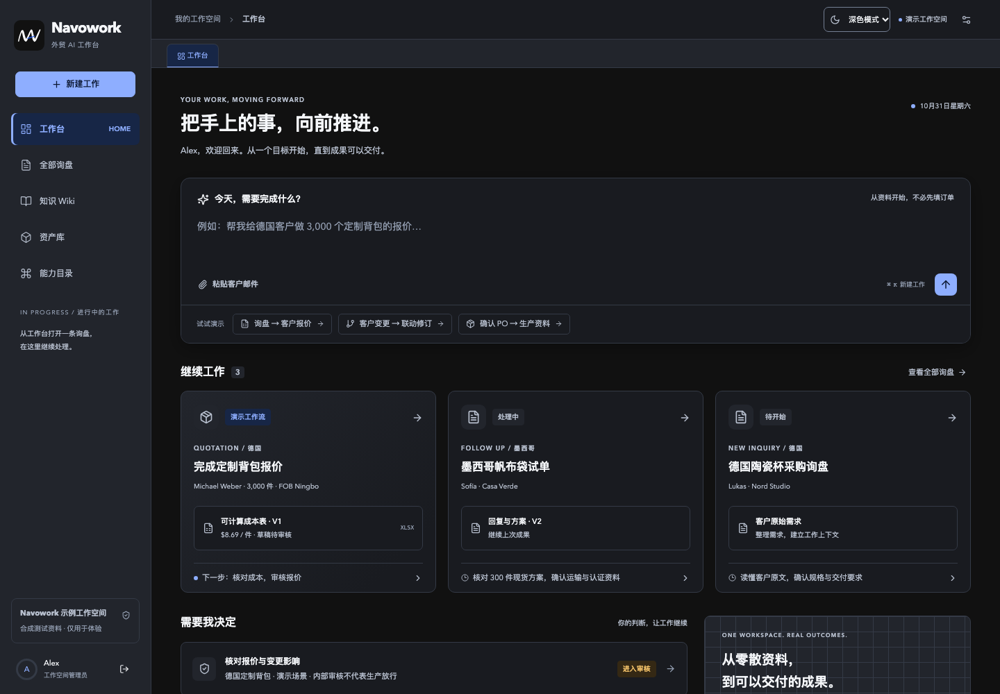
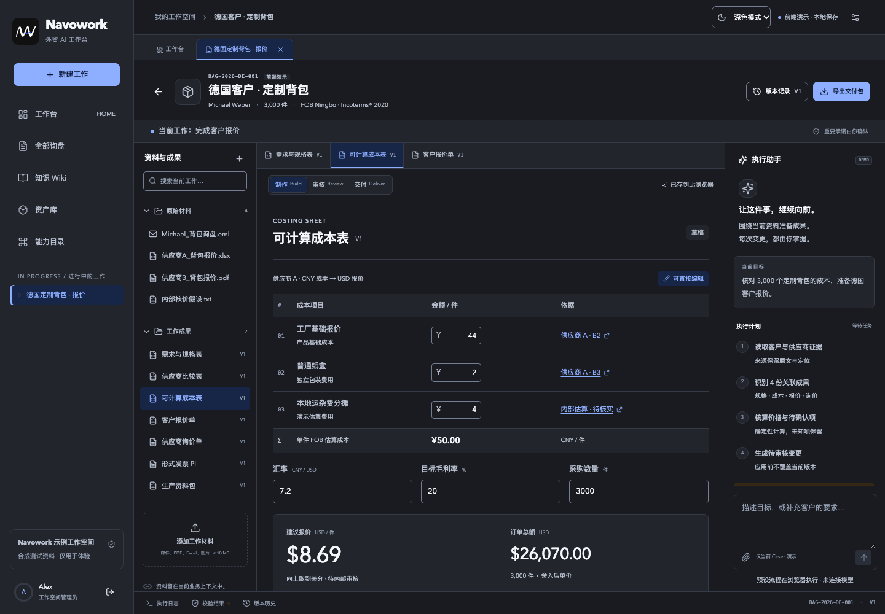

# Navowork 前端品牌主题接入

日期：2026-10-31（Asia/Shanghai）

范围：现有 React 前端的品牌标识、颜色和主题交互。品牌素材版本 4.1.0，图标轮廓沿用用户确认的 v4。

## 交付结果

已将确认的 NAW 手绘图标与品牌配色接入登录页、导航、任务首页、工作画布、原询盘页、知识 Wiki、资产库、能力目录及弹窗。页面名称统一使用 Navowork，浏览器标题、favicon、Apple 图标和工作区打印稿一并更新。

浅色模式采用黑色主体与白色图标底，深色模式采用白色主体与墨黑图标底；两个版本的 A 横杠都保留品牌蓝 `#245BEB`。6 份 SVG 与确认稿逐文件比较完全一致，没有调整几何轮廓。

外观选择器位于登录页右上角和工作空间顶部，提供“跟随系统 / 浅色模式 / 深色模式”。默认跟随系统，手动选择后保存偏好；刷新、退出再登录及同源多标签之间保持一致。切换主题不会重建工作画布或丢失报价输入。

## 通用色和产品色

| 角色                | 浅色模式  | 深色模式  |
| ------------------- | --------- | --------- |
| 页面背景            | `#F7F8FA` | `#111111` |
| 卡片 / 编辑画布     | `#FFFFFF` | `#191B20` |
| 弹窗                | `#FFFFFF` | `#22252C` |
| 正文                | `#111111` | `#F5F7FA` |
| 次级文字            | `#4C586B` | `#B8C0CF` |
| 主操作 / 链接       | `#245BEB` | `#8EAEFF` |
| 主操作文字          | `#FFFFFF` | `#0B1730` |
| 选中背景            | `#E8F0FF` | `#172646` |
| 成功文字            | `#177444` | `#79DDA0` |
| 待确认 / 待审核文字 | `#915900` | `#F3C269` |
| 错误文字            | `#B32E3B` | `#FF9EA8` |

品牌蓝保持固定；深色主题中的按钮和链接使用更亮的产品操作蓝，以保证可读性。蓝色表达操作、选中和运行中；绿色表达成功或已通过；橙色表达待确认或待审核；红色表达错误。状态同时保留文字说明。完整的每主题 44 个颜色角色见 `src/theme/tokens.json` 和 `src/theme/tokens.css`。

页面颜色已改为语义变量，包含背景、文字、控件边界、悬停、按下、禁用、焦点、遮罩及状态。原有 `--primary`、`--ink`、`--trade-green` 等变量保留为兼容别名，均指向新配色。打印预览固定为白底黑字和黑色透明标志，不跟随应用深色主题。

## 代码入口与维护方式

| 文件                               | 职责                                                     |
| ---------------------------------- | -------------------------------------------------------- |
| `public/brand/`                    | 已确认的双主题 SVG、透明标志、微型 favicon 和 Apple 图标 |
| `public/theme-init.js`             | React 加载前应用主题；系统偏好和跨标签同步；存储失败降级 |
| `src/theme/ThemeSwitch.tsx`        | 有可访问名称的主题选择器，订阅共享主题状态               |
| `src/theme/tokens.css`             | 首屏直接加载的主题变量和图标切换规则                     |
| `src/theme/tokens.json`            | 同一配色的结构化交付数据                                 |
| `src/theme/brand.css`              | 品牌组件及通用交互样式                                   |
| `src/components/BrandMark.tsx`     | 复用双主题图标，保持比例和固定尺寸                       |
| `src/App.tsx`                      | 登录与应用外壳中的品牌及主题入口                         |
| `src/features/workbench/export.ts` | 工作成果打印稿的品牌与固定浅色样式                       |
| `tests/e2e/theme.spec.ts`          | 6 项主题交互与异常场景浏览器测试                         |

主题使用 `localStorage` 的独立键 `navowork:theme`，允许值为 `system`、`light`、`dark`。共享状态由 `window.navoworkTheme` 管理，React 使用 `useSyncExternalStore` 订阅；不要在新页面另建主题状态或直接写这个存储键。要切换主题，调用 `window.navoworkTheme.setPreference(value)`。

`index.html` 在 CSS 和 React 之前同步加载 `theme-init.js`，在 `<html>` 设置 `data-theme`、`data-theme-preference` 与 `color-scheme`，同时更新 favicon 和浏览器主题色。保持这个加载顺序，避免深色模式刷新时先出现浅色背景。本地存储被浏览器拒绝时仍可在当前页面切换，并显示“主题仅在当前页面生效”。

新组件引用 `--navo-color-*`，避免写死页面颜色；产品交互使用 `action` / `selection` / `status` 等角色，不直接拿 Logo 的蓝色代替。更新正式色值时同步维护 CSS、JSON 和品牌规范，尤其是 CSS 中系统深色回退与显式深色两个变量块。JSON 是交付数据，运行时读取 CSS，二者不会自动互相生成。

原有 `easywork-*` 存储键、IndexedDB、会话事件名及 API 合同保持兼容，避免改名造成已有草稿或工作数据丢失。没有增加前端依赖。

## 验证与边界

- 生产构建及 TypeScript 检查通过；28 项单元测试通过。
- 完整 Chromium 回归：33 项全部通过，包含新增的 6 项主题测试。
- 主题测试覆盖首屏恢复、系统切换、手动覆盖、刷新与退出登录、跨标签同步、存储被禁用、延迟加载页面、弹窗、390px 导航和输入保留。
- 生产构建单独验证了登录、切换和刷新、工作画布、移动端，以及阻止 React 入口加载时仍能恢复深色背景和 favicon。
- 深色工作区打开的打印稿实测为白底黑字，Navowork 标志加载成功；该验证路径未发现页面异常或 HTTP 资源错误。
- 1440px 桌面与 390px 手机截图已检查；手机页面无横向溢出。所有引用的 CSS 变量都有定义。
- 沿用项目的前端演示与真实接口边界。本次没有实现后端认证、真实模型执行或团队服务端存储，也没有进行线上部署。自动浏览器回归使用 Chromium，未运行 Safari / Firefox 的完整回归。

## 预览

在仓库根目录运行 `npm run dev`，打开 [Navowork 本地预览](http://127.0.0.1:5173/)。

其余截图：`navowork-login-light.png`、`navowork-workbench-light.png`、`navowork-mobile-dark.png`，均位于 `docs/screenshots/`。
